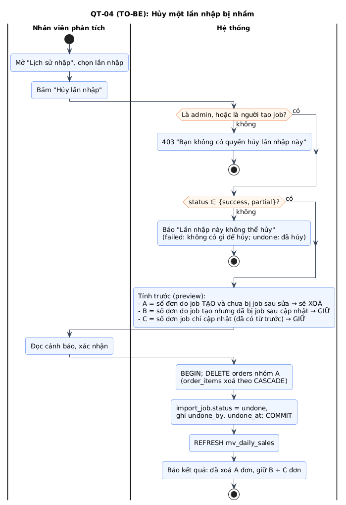

# Chương 2. QUY TRÌNH NGHIỆP VỤ

> **Cách đọc:** mỗi quy trình có (1) sơ đồ activity có swimlane, (2) bảng các bước: _ai làm, làm gì, dữ liệu vào/ra, quy tắc áp dụng_, (3) ngoại lệ. Quy trình TO-BE là **hợp đồng hành vi**: code phải chạy đúng như vậy, test phải kiểm chứng đúng các nhánh này.

## 2.0 Bức tranh tổng thể


_Hình H1 — Sơ đồ ngữ cảnh: hệ thống trao đổi với 4 tác nhân người/thời gian và 3 loại nguồn dữ liệu._

**Chu trình vận hành thực tế trong một tuần (kịch bản mẫu, dùng để demo):**

```
 Hằng ngày 08:30  Nhân viên xuất file POS hôm qua ──► QT-01 Nhập file (≈ 3 phút)
 Hằng ngày 23:00  Bộ lập lịch ──► QT-02 Đồng bộ nguồn REST API / CSDL (tự động)
 Bất kỳ lúc nào   Chủ shop mở điện thoại ──► QT-03 Xem dashboard, so sánh tuần trước
 Thứ Hai          Nhân viên xuất file Shopee tuần trước ──► QT-01 (mẫu ánh xạ "Shopee" đã lưu)
 Khi nhập nhầm    Nhân viên ──► QT-04 Hủy lần nhập ──► QT-01 nhập lại file đúng
 Khi có NV mới    Chủ shop ──► QT-05 Cấp tài khoản, chọn vai trò
```

## 2.1 Quy trình hiện tại (AS-IS)


_Hình H2 — Quy trình tổng hợp báo cáo thủ công hiện nay. Ghi chú vàng là các vấn đề P1–P6._

| Bước | Ai        | Mô tả                                                                 | Vấn đề |
| ---- | --------- | --------------------------------------------------------------------- | ------ |
| 1    | Nhân viên | Xuất file từ POS, Seller Center; chép tay đơn Facebook/Zalo           | P1     |
| 2    | Nhân viên | Dán vào file Excel tổng, sửa tay tên cột, ngày, số tiền, tên sản phẩm | P2, P3 |
| 3    | Nhân viên | (Thường bỏ qua) lọc đơn hủy, đơn trùng                                | P4     |
| 4    | Nhân viên | Tạo PivotTable, biểu đồ, chụp ảnh gửi Zalo                            | P8     |
| 5    | Chủ shop  | Xem; muốn góc nhìn khác thì nhắn nhân viên làm lại                    | P5     |
| 6    | Chủ shop  | Ra quyết định dựa trên số liệu có thể sai, không so được kỳ trước     | P6     |

**Nhận xét phân tích:** điểm nghẽn không nằm ở việc _vẽ biểu đồ_ (Excel vẽ được) mà ở bước **2–3: chuẩn hoá và làm sạch dữ liệu**. Vì vậy phần lớn công sức đồ án (Sprint 2–3) dồn vào pipeline nhập dữ liệu, không phải giao diện biểu đồ. Đây là luận điểm quan trọng khi giải thích phân bổ thời gian với GVHD.

## 2.2 QT-01 — Nhập dữ liệu bán hàng từ file (TO-BE)


_Hình H3 — Nhập dữ liệu từ file CSV/Excel. Use case liên quan: UC05, UC06, UC09._

| Bước | Ai        | Hoạt động                                                                                           | Dữ liệu vào → ra                   | Quy tắc            |
| ---- | --------- | --------------------------------------------------------------------------------------------------- | ---------------------------------- | ------------------ |
| 1    | Nhân viên | Xuất file từ nguồn (ngoài hệ thống); nếu chưa có mẫu thì tải **file mẫu** (UC09)                    | — → file .csv/.xlsx                | —                  |
| 2    | Nhân viên | Chọn file trên trang "Nhập dữ liệu"                                                                 | file → request multipart           | —                  |
| 3    | Hệ thống  | Kiểm tra đuôi, MIME, dung lượng                                                                     | file → hợp lệ / 400 / 413          | BR-16              |
| 4    | Hệ thống  | Đọc tên cột + 20 dòng đầu; nhận dạng mã hoá (BOM), dấu phân cách                                    | file → `{columns[], sampleRows[]}` | FR-11              |
| 5    | Hệ thống  | Gợi ý ánh xạ: mẫu đã lưu có cùng tập cột → áp dụng; nếu không thì đoán theo từ điển đồng nghĩa      | columns → mapping đề xuất          | FR-12              |
| 6    | Nhân viên | Xác nhận/sửa ánh xạ, chọn định dạng ngày, đặt giá trị cố định (vd. kênh = `shopee`)                 | mapping đề xuất → mapping cuối     | FR-13              |
| 7    | Hệ thống  | Kiểm tra đủ **trường bắt buộc** (bảng 3.5); thiếu → báo tên trường, quay lại bước 6                 | mapping → OK / danh sách thiếu     | §3.5               |
| 8    | Nhân viên | Bấm "Nhập dữ liệu", tuỳ chọn lưu mẫu ánh xạ                                                         | —                                  | FR-14              |
| 9    | Hệ thống  | Tạo `import_job` (`pending`), trả **202 + jobId**; xử lý nền                                        | file + mapping → job               | FR-18              |
| 10   | Hệ thống  | Với **từng dòng**: áp ánh xạ → chuẩn hoá → validate; hợp lệ → `staging_rows`, lỗi → `import_errors` | dòng → staging / error             | BR-07…BR-14        |
| 11   | Hệ thống  | Kiểm tra nhất quán theo đơn: các dòng cùng mã đơn mâu thuẫn thông tin cấp đơn → cả đơn sang lỗi     | staging → staging / error          | BR-07              |
| 12   | Hệ thống  | Nếu ≥ 1 dòng hợp lệ: **1 transaction** upsert danh mục → sản phẩm → khách → kênh → đơn → dòng đơn   | staging → bảng core                | BR-06, BR-11…BR-14 |
| 13   | Hệ thống  | `REFRESH MATERIALIZED VIEW CONCURRENTLY mv_daily_sales`; cập nhật trạng thái job                    | —                                  | BR-15              |
| 14   | Hệ thống  | Hiển thị kết quả: tổng dòng, OK, lỗi, **đơn mới**, **đơn cập nhật**                                 | job → màn hình kết quả             | FR-19              |
| 15   | Nhân viên | Có lỗi → tải CSV dòng lỗi, sửa file gốc, **nhập lại cả file** (an toàn nhờ BR-06)                   | —                                  | FR-21              |

**Ngoại lệ:**

| Mã  | Tình huống                                         | Xử lý                                                                                                                    |
| --- | -------------------------------------------------- | ------------------------------------------------------------------------------------------------------------------------ |
| E1  | File rỗng / chỉ có tiêu đề                         | 400 "File không có dữ liệu" (không tạo job)                                                                              |
| E2  | Tiêu đề cột trùng nhau                             | Tự đổi tên `Cột (2)` và cảnh báo ở bước ánh xạ                                                                           |
| E3  | Quá giới hạn số dòng (BR-16)                       | 400 trước khi xử lý, gợi ý chia file                                                                                     |
| E4  | Không có dòng hợp lệ nào và có dòng lỗi            | Job `failed`, không ghi gì vào bảng core                                                                                 |
| E5  | Lỗi CSDL khi load (mất kết nối, vi phạm ràng buộc) | `ROLLBACK`, job `failed`, `error_message` ghi lý do kỹ thuật (chỉ admin xem)                                             |
| E6  | Server khởi động lại giữa chừng                    | Job mồ côi → `failed` khi khởi động (F7.4); người dùng nhập lại                                                          |
| E7  | Hai người nhập cùng lúc hai file có đơn trùng      | Transaction + `ON CONFLICT` đảm bảo không lỗi; đơn nhận dữ liệu của job commit sau ("last write wins") — ghi vào hạn chế |

## 2.3 QT-02 — Kết nối và đồng bộ từ nguồn CSDL / REST API (TO-BE)


_Hình H4 — Gồm 2 phần: (a) admin khai báo nguồn; (b) đồng bộ được kích hoạt bởi Bộ lập lịch hoặc nhân viên. Use case: UC10–UC13._

| Bước | Ai                      | Hoạt động                                                                                                                                                                                                | Quy tắc                    |
| ---- | ----------------------- | -------------------------------------------------------------------------------------------------------------------------------------------------------------------------------------------------------- | -------------------------- | --- |
| a1   | Admin                   | Chọn loại nguồn, nhập thông tin kết nối (CSDL: host/port/db/user/password/SSL + câu `SELECT`; REST: base URL, header xác thực, đường dẫn tới mảng dữ liệu, kiểu phân trang, tên tham số `updated_since`) | FR-24, FR-25               |
| a2   | Admin → Hệ thống        | "Kiểm tra kết nối": thử kết nối, timeout 10 s, lấy 20 bản ghi mẫu                                                                                                                                        | FR-26, BR-25               |
| a3   | Admin                   | Ánh xạ cột trên 20 bản ghi mẫu (dùng chung UI với QT-01); đặt lịch                                                                                                                                       | FR-13, FR-28               |
| a4   | Hệ thống                | Mã hoá cấu hình AES-256-GCM, lưu; đăng ký cron                                                                                                                                                           | BR-24                      |
| b1   | Bộ lập lịch / Nhân viên | Kích hoạt đồng bộ (theo cron, hoặc "Đồng bộ ngay")                                                                                                                                                       | FR-27                      |
| b2   | Hệ thống                | `pg_try_advisory_lock(source_id)`: không lấy được → bỏ qua (cron) / báo "Đang đồng bộ" (thủ công, 409)                                                                                                   | BR-19                      |
| b3   | Hệ thống                | Tạo job (`trigger = schedule                                                                                                                                                                             | manual`), giải mã cấu hình | —   |
| b4   | Hệ thống ↔ Nguồn        | Lấy dữ liệu **tăng dần** từ `last_synced_at`, theo trang/lô; mỗi trang qua pipeline chung                                                                                                                | BR-18                      |
| b5   | Hệ thống                | Lỗi mạng/429/5xx: retry 3 lần (1 s, 2 s, 4 s); vẫn lỗi → job `failed`, **không** cập nhật `last_synced_at`                                                                                               | BR-18                      |
| b6   | Hệ thống                | Thành công → load (như QT-01 bước 12–13), `last_synced_at = thời điểm BẮT ĐẦU job`                                                                                                                       | BR-18                      |
| b7   | Hệ thống                | Giải phóng khoá                                                                                                                                                                                          | BR-19                      |

> **Vì sao `last_synced_at` = thời điểm _bắt đầu_ chứ không phải _kết thúc_?** Bản ghi được sửa ở nguồn **trong lúc** job đang chạy có `updated_at` nằm giữa lúc bắt đầu và lúc kết thúc. Nếu lấy thời điểm kết thúc làm mốc, lần sau sẽ bỏ sót chúng. Lấy thời điểm bắt đầu thì có thể lấy trùng vài bản ghi, nhưng nhờ upsert (BR-06) nên trùng là vô hại. Nguyên tắc: **thà trùng còn hơn sót** khi đã có idempotency.

## 2.4 QT-03 — Xem phân tích và ra quyết định (TO-BE)


_Hình H5 — Use case: UC14, UC15, UC16._

| Bước | Ai            | Hoạt động                                                                           | Quy tắc            |
| ---- | ------------- | ----------------------------------------------------------------------------------- | ------------------ |
| 1    | Người dùng    | Mở dashboard (trang chủ hoặc link chia sẻ có `?from=&to=&channel=&category=`)       | FR-38              |
| 2    | Hệ thống      | Chưa đăng nhập → `/login?next=<link>`; đăng nhập xong quay lại đúng link            | FR-03              |
| 3    | Hệ thống      | Bộ lọc mặc định: **30 ngày gần nhất tính cả hôm nay**, mọi kênh, mọi danh mục       | BR-22              |
| 4    | Hệ thống      | Gọi song song 5 API (summary, revenue-trend, top-products, by-category, by-channel) | NFR-01             |
| 5    | Hệ thống      | Hiển thị KPI kèm delta, biểu đồ, dòng "Dữ liệu cập nhật lúc HH:mm dd/MM"            | FR-30…FR-34, FR-39 |
| 6    | Người dùng    | Đổi bộ lọc / click một cột danh mục hoặc kênh để lọc chéo; URL cập nhật             | FR-35…FR-37        |
| 7    | Analyst/Admin | "Xuất CSV" theo đúng bộ lọc đang xem                                                | FR-40              |
| 8    | Người dùng    | Ra quyết định ngoài hệ thống                                                        | —                  |

**Câu hỏi kinh doanh → nơi trả lời** (dùng để kiểm thử UAT ở S7.4):

| Câu hỏi của chủ shop                                 | Trả lời bằng             | Thao tác                                |
| ---------------------------------------------------- | ------------------------ | --------------------------------------- |
| Tháng này bán được bao nhiêu, hơn tháng trước không? | KPI Doanh thu + delta    | Preset "Tháng này"                      |
| Sản phẩm nào bán chạy nhất tháng trước?              | Top sản phẩm             | Preset "Tháng trước", sắp theo số lượng |
| Kênh nào đang mang lại nhiều tiền nhất?              | Biểu đồ theo kênh        | —                                       |
| Doanh thu có theo mùa/cuối tuần không?               | Xu hướng theo ngày/tuần  | Khoảng 90 ngày, độ chi tiết "ngày"      |
| Trên Shopee, danh mục nào bán tốt?                   | Theo danh mục + lọc kênh | Chọn kênh `shopee`                      |
| Giá trị trung bình mỗi đơn có tăng không?            | KPI AOV + delta          | —                                       |

## 2.5 QT-04 — Hủy một lần nhập bị nhầm (TO-BE)



_Hình H6 — Use case UC08. Quy tắc BR-17._

**Vấn đề thiết kế cần hiểu (vì sao không chỉ "xoá mọi đơn của job"):** nhập liệu dùng **upsert**, nên một job có thể (a) **tạo mới** đơn, hoặc (b) **cập nhật** đơn đã có từ job trước. Ngoài ra, đơn do job J tạo có thể bị (c) **job sau sửa tiếp**. Nếu hủy J mà xoá mọi đơn J từng đụng tới:

- trường hợp (b) → xoá mất đơn **có từ trước** J → mất dữ liệu đúng;
- trường hợp (c) → xoá mất phần job sau đã cập nhật.

**Giải pháp đã chọn:** lưu 2 cột trên `orders`: `created_job_id` (job tạo ra đơn) và `last_job_id` (job ghi gần nhất). Hủy J chỉ xoá đơn có `created_job_id = J AND last_job_id = J`. Các đơn còn lại được giữ và **báo rõ số lượng** cho người dùng trước khi xác nhận.

| Phương án                                     | Ưu                                             | Nhược                                       | Chọn?                |
| --------------------------------------------- | ---------------------------------------------- | ------------------------------------------- | -------------------- |
| A. Xoá mọi đơn có `import_job_id = J` (1 cột) | Đơn giản                                       | Sai ở trường hợp (b), (c): mất dữ liệu      | ✗                    |
| **B. 2 cột `created_job_id` + `last_job_id`** | Đúng cho (a); an toàn cho (b), (c); thêm 1 cột | Không **khôi phục** được giá trị cũ của (b) | **✓**                |
| C. Lưu snapshot/lịch sử phiên bản mỗi đơn     | Hoàn tác hoàn hảo                              | Phức tạp, tốn dung lượng, vượt phạm vi      | ✗ (hướng phát triển) |

## 2.6 QT-05 — Cấp và quản lý tài khoản (TO-BE)

Quy trình ngắn, không vẽ activity riêng (đặc tả ở UC04).

| Bước | Ai              | Hoạt động                                                                         | Quy tắc                         |
| ---- | --------------- | --------------------------------------------------------------------------------- | ------------------------------- |
| 1    | Admin (lần đầu) | Chạy script `create-admin` khi deploy (chưa có UI vì chưa có ai đăng nhập được)   | —                               |
| 2    | Admin           | Thêm người dùng: email, họ tên, vai trò, mật khẩu tạm                             | FR-06, BR-20                    |
| 3    | Admin           | Gửi mật khẩu tạm cho nhân viên **ngoài hệ thống** (trực tiếp/Zalo)                | Không gửi email (ngoài phạm vi) |
| 4    | Nhân viên       | Đăng nhập lần đầu → **bắt buộc đổi mật khẩu**                                     | FR-08                           |
| 5    | Admin           | Nhân viên nghỉ việc → **khoá** tài khoản (không xoá, để giữ lịch sử "ai đã nhập") | FR-07, BR-21                    |
| 6    | Hệ thống        | Tài khoản bị khoá / đổi mật khẩu → phiên cũ hết hiệu lực ngay ở request kế tiếp   | BR-21                           |

## 2.7 Vòng đời trạng thái lần nhập


_Hình H7 — Mọi quy trình QT-01, QT-02, QT-04 đều thay đổi `import_jobs.status` theo sơ đồ này. Trong CSDL: `CHECK (status IN ('pending','running','success','partial','failed','undone'))`._

| Từ → Đến                     | Điều kiện                                                                   | Ai/gì kích hoạt                |
| ---------------------------- | --------------------------------------------------------------------------- | ------------------------------ |
| — → `pending`                | Upload xong / bấm đồng bộ / đến lịch                                        | API                            |
| `pending` → `running`        | Worker bắt đầu đọc dữ liệu                                                  | Worker trong process API       |
| `running` → `success`        | Không lỗi hệ thống, `error_rows = 0` (kể cả khi mọi dòng bị bỏ qua — BR-08) | Worker                         |
| `running` → `partial`        | Load commit, `error_rows > 0`, `ok_rows > 0`                                | Worker                         |
| `running` → `failed`         | `ok_rows = 0` và `error_rows > 0`, hoặc lỗi hệ thống/mạng (đã rollback)     | Worker                         |
| `pending/running` → `failed` | Job cũ hơn 30 phút lúc server khởi động                                     | Tác vụ F7.4                    |
| `success/partial` → `undone` | UC08 thành công                                                             | Analyst (job của mình) / Admin |

**Bảng chuyển trạng thái không hợp lệ** (phải bị chặn, viết test): `failed → undone`, `undone → undone`, `success → running`, mọi chuyển từ `undone`.
