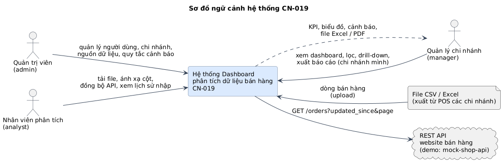
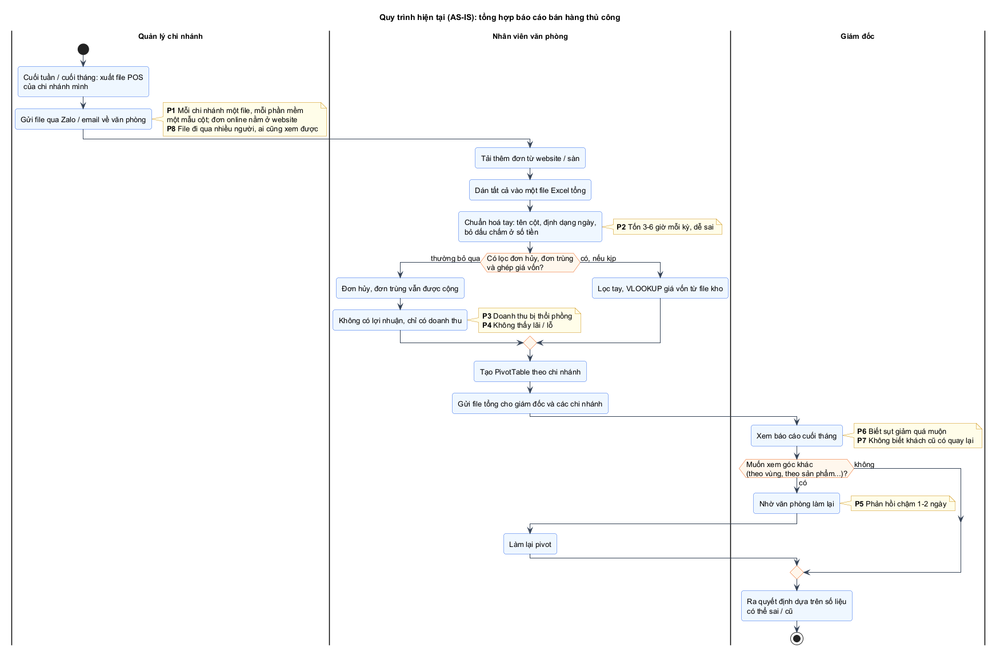
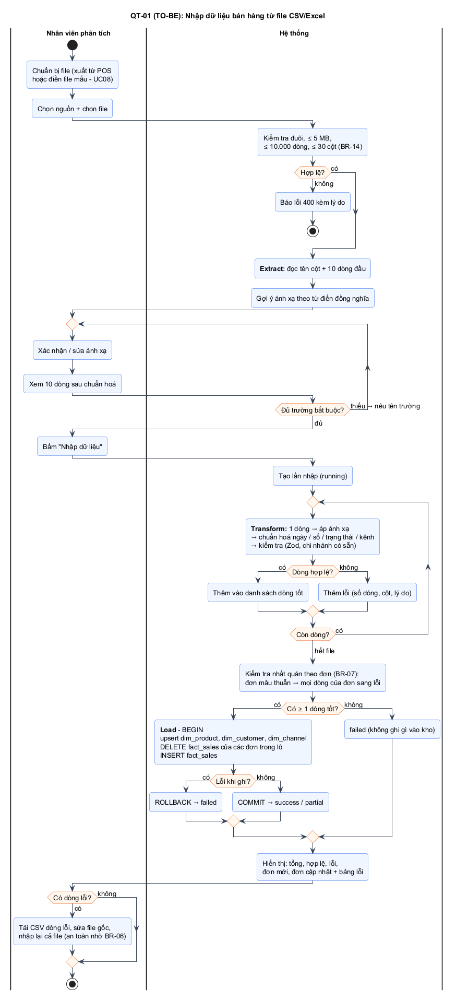
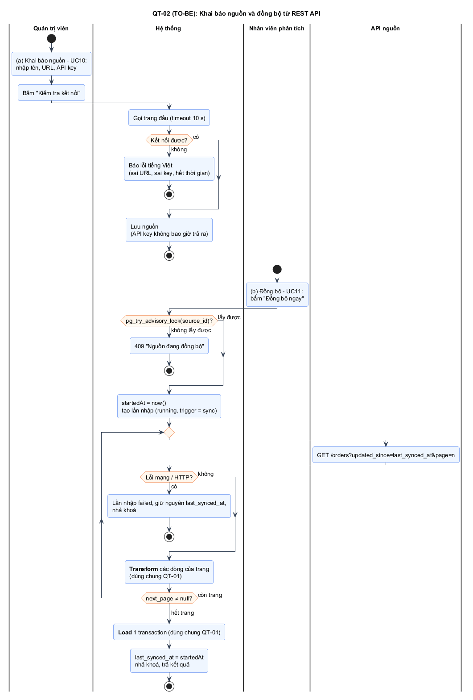
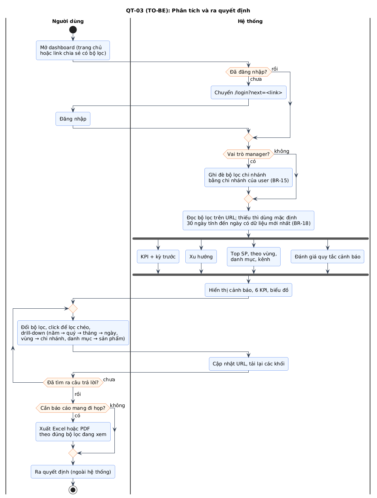
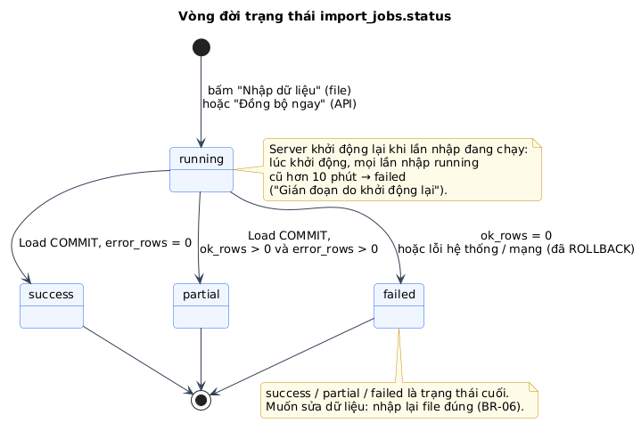

# Chương 2. QUY TRÌNH NGHIỆP VỤ

> **Cách đọc:** mỗi quy trình có (1) sơ đồ activity có swimlane, (2) bảng các bước: _ai làm, làm gì, quy tắc áp dụng_, (3) ngoại lệ. Quy trình TO-BE là **hợp đồng hành vi**: code phải chạy đúng như vậy, test phải kiểm chứng đúng các nhánh này.

## 2.0 Bức tranh tổng thể



_Hình H1 - Sơ đồ ngữ cảnh: hệ thống trao đổi với 3 nhóm người dùng và 2 loại nguồn dữ liệu._

**Một tuần vận hành mẫu (dùng làm kịch bản demo):**

```
 Hằng ngày 08:30   Nhân viên phân tích nhận file POS hôm qua của các chi nhánh ──► QT-01 Nhập file
 Hằng ngày 09:00   Nhân viên phân tích bấm "Đồng bộ ngay" nguồn website      ──► QT-02 Đồng bộ API
 Bất kỳ lúc nào    Giám đốc mở dashboard toàn chuỗi; thấy cảnh báo            ──► QT-03 Phân tích
 Bất kỳ lúc nào    Quản lý chi nhánh Đà Nẵng mở dashboard (chỉ thấy DN01)     ──► QT-03 Phân tích
 Thứ Hai           Giám đốc xuất báo cáo tuần (Excel/PDF) gửi họp giao ban    ──► QT-03 bước xuất
 Khi có chi nhánh / nhân sự mới   Admin khai báo chi nhánh, cấp tài khoản     ──► QT-04
```

## 2.1 Quy trình hiện tại (AS-IS)



_Hình H2 - Quy trình tổng hợp báo cáo thủ công hiện nay. Ghi chú vàng là các vấn đề P1-P8._

| Bước | Ai                  | Mô tả                                                                      | Vấn đề     |
| ---- | ------------------- | -------------------------------------------------------------------------- | ---------- |
| 1    | Quản lý chi nhánh   | Xuất file POS của chi nhánh, gửi qua Zalo/email cho văn phòng              | P1, P8     |
| 2    | Nhân viên văn phòng | Tải đơn website/sàn; dán tất cả vào file Excel tổng, sửa tay cột, ngày, số | P1, P2     |
| 3    | Nhân viên văn phòng | (Thường bỏ qua) lọc đơn hủy, đơn trùng; ghép giá vốn từ file kho           | P3, P4     |
| 4    | Nhân viên văn phòng | Tạo PivotTable, biểu đồ theo chi nhánh; gửi file tổng cho mọi người        | P5, P8     |
| 5    | Giám đốc            | Xem cuối tháng; muốn góc nhìn khác thì nhờ làm lại                         | P5, P6, P7 |

**Nhận xét phân tích:** điểm nghẽn không nằm ở _vẽ biểu đồ_ (Excel vẽ được) mà ở bước **2-3: gom và làm sạch dữ liệu**, và ở chỗ **không có mô hình dữ liệu chung** để nhìn đa chiều. Vì vậy đồ án dồn công sức vào ETL và kho dữ liệu hình sao; sau đó dashboard chỉ còn là các truy vấn tổng hợp trên kho.

## 2.2 QT-01 - Nhập dữ liệu bán hàng từ file (TO-BE)



_Hình H3 - Nhập dữ liệu từ file CSV/Excel. Use case: UC06, UC07, UC08, UC09._

| Bước | Ai       | Hoạt động                                                                                                              | Quy tắc       |
| ---- | -------- | ---------------------------------------------------------------------------------------------------------------------- | ------------- |
| 1    | Analyst  | Chuẩn bị file (xuất từ POS hoặc điền **file mẫu** - UC08)                                                              | -             |
| 2    | Analyst  | Trên trang "Nhập dữ liệu": chọn **nguồn** (vd. "POS chi nhánh") và chọn file                                           | FR-08         |
| 3    | Hệ thống | Kiểm tra đuôi, dung lượng, số dòng, số cột                                                                             | BR-14         |
| 4    | Hệ thống | **Extract:** đọc tên cột + 10 dòng đầu; gợi ý ánh xạ theo từ điển đồng nghĩa                                           | FR-09, §3.5.3 |
| 5    | Analyst  | Xác nhận/sửa ánh xạ; xem 10 dòng **sau chuẩn hoá**                                                                     | FR-09         |
| 6    | Hệ thống | Kiểm tra đủ trường bắt buộc; thiếu → nêu tên trường, quay lại bước 5                                                   | §3.5.1        |
| 7    | Analyst  | Bấm "Nhập dữ liệu"                                                                                                     | -             |
| 8    | Hệ thống | **Transform:** với từng dòng: áp ánh xạ → chuẩn hoá → kiểm tra; hợp lệ → danh sách dòng tốt, lỗi → danh sách lỗi       | BR-08…BR-12   |
| 9    | Hệ thống | Kiểm tra nhất quán theo đơn; đơn mâu thuẫn → mọi dòng của đơn sang lỗi                                                 | BR-07         |
| 10   | Hệ thống | **Load** (nếu có ≥ 1 dòng tốt): **1 transaction** upsert bảng chiều → xoá dòng cũ của các đơn trong lô → chèn dòng mới | BR-06         |
| 11   | Hệ thống | Ghi lần nhập (`success`/`partial`/`failed`) và các dòng lỗi                                                            | BR-13         |
| 12   | Hệ thống | Hiển thị kết quả: tổng, hợp lệ, lỗi, **đơn mới**, **đơn cập nhật**, bảng lỗi                                           | FR-12         |
| 13   | Analyst  | Có lỗi → tải CSV dòng lỗi, sửa file gốc, **nhập lại cả file** (an toàn nhờ BR-06)                                      | FR-13         |

**Ngoại lệ:**

| Mã  | Tình huống                                         | Xử lý                                                                             |
| --- | -------------------------------------------------- | --------------------------------------------------------------------------------- |
| E1  | File rỗng / chỉ có tiêu đề                         | 400 "File không có dữ liệu" (không tạo lần nhập)                                  |
| E2  | Sai đuôi, > 5 MB, > 10.000 dòng, > 30 cột          | 400 kèm lý do; gợi ý chia nhỏ file                                                |
| E3  | Không có dòng hợp lệ nào                           | Lần nhập `failed`, kho không đổi                                                  |
| E4  | Lỗi CSDL khi Load (mất kết nối, vi phạm ràng buộc) | `ROLLBACK`, lần nhập `failed`, `error_message` ghi lý do kỹ thuật (chỉ admin xem) |
| E5  | Hai người nhập cùng lúc hai file có đơn trùng      | Transaction của lần commit sau thắng ("last write wins"); ghi vào hạn chế         |

## 2.3 QT-02 - Đồng bộ dữ liệu từ REST API (TO-BE)



_Hình H4 - (a) admin khai báo nguồn; (b) analyst đồng bộ. Use case: UC10, UC11._

| Bước | Ai               | Hoạt động                                                                                                | Quy tắc       |
| ---- | ---------------- | -------------------------------------------------------------------------------------------------------- | ------------- |
| a1   | Admin            | Khai báo nguồn API: tên, URL, API key                                                                    | FR-15         |
| a2   | Admin → Hệ thống | "Kiểm tra kết nối": gọi trang đầu, timeout 10 s                                                          | FR-16         |
| a3   | Hệ thống         | Lưu nguồn; API key không bao giờ trả ra                                                                  | FR-15, NFR-14 |
| b1   | Analyst          | Bấm "Đồng bộ ngay" trên nguồn                                                                            | FR-17         |
| b2   | Hệ thống         | `pg_try_advisory_lock(source_id)`: không lấy được → 409 "Nguồn đang đồng bộ"                             | FR-18         |
| b3   | Hệ thống ↔ API   | **Extract:** gọi `GET /orders?updated_since=<last_synced_at>&page=1, 2…` tới khi hết trang               | BR-16         |
| b4   | Hệ thống         | **Transform + Load:** đúng bước 8-11 của QT-01 (dùng chung code)                                         | BR-06…BR-13   |
| b5   | Hệ thống         | Thành công → `last_synced_at = thời điểm BẮT ĐẦU`; lỗi mạng/HTTP → lần nhập `failed`, **giữ nguyên** mốc | BR-16         |
| b6   | Hệ thống         | Nhả khoá, trả kết quả như QT-01 bước 12                                                                  | -             |

> **Vì sao `last_synced_at` = thời điểm _bắt đầu_?** Bản ghi được sửa ở nguồn **trong lúc** đang đồng bộ có `updated_at` nằm giữa lúc bắt đầu và lúc kết thúc. Lấy thời điểm kết thúc làm mốc sẽ bỏ sót chúng. Lấy thời điểm bắt đầu thì lần sau có thể lấy trùng vài bản ghi, nhưng nhờ nạp idempotent (BR-06) nên trùng là vô hại. Nguyên tắc: **thà trùng còn hơn sót** khi đã có idempotency.

## 2.4 QT-03 - Phân tích và ra quyết định (TO-BE)



_Hình H5 - Use case: UC12-UC15, UC17._

| Bước | Ai         | Hoạt động                                                                                             | Quy tắc            |
| ---- | ---------- | ----------------------------------------------------------------------------------------------------- | ------------------ |
| 1    | Người dùng | Mở dashboard (trang chủ hoặc link chia sẻ có bộ lọc trên URL)                                         | FR-24              |
| 2    | Hệ thống   | Chưa đăng nhập → `/login?next=<link>`; đăng nhập xong quay lại đúng link                              | FR-03              |
| 3    | Hệ thống   | Manager → ép bộ lọc chi nhánh = chi nhánh của mình                                                    | BR-15              |
| 4    | Hệ thống   | Bộ lọc mặc định: 30 ngày tính đến ngày có dữ liệu mới nhất; mọi chi nhánh/danh mục/kênh được phép     | BR-18              |
| 5    | Hệ thống   | Gọi song song các API: KPI, xu hướng, top sản phẩm, theo vùng, theo danh mục, theo kênh, **cảnh báo** | FR-19…FR-23, FR-29 |
| 6    | Hệ thống   | Hiển thị **cảnh báo** ở đầu trang (nếu có), 6 thẻ KPI có delta, các biểu đồ                           | BR-05, BR-20       |
| 7    | Người dùng | Đổi bộ lọc; **click** vùng/danh mục/kênh để lọc chéo; **drill-down** thời gian, vùng, danh mục        | FR-24…FR-27        |
| 8    | Người dùng | "Xuất Excel" hoặc "Xuất PDF" theo đúng bộ lọc đang xem                                                | FR-32, FR-33       |
| 9    | Người dùng | Ra quyết định ngoài hệ thống                                                                          | -                  |

**Câu hỏi kinh doanh → nơi trả lời** (dùng làm kịch bản kiểm thử với người dùng - UAT):

| Câu hỏi                                                     | Trả lời bằng                       | Thao tác                                 |
| ----------------------------------------------------------- | ---------------------------------- | ---------------------------------------- |
| Tháng này bán và lãi được bao nhiêu, hơn tháng trước không? | KPI Doanh thu, Lợi nhuận + delta   | Preset "Tháng này"                       |
| Sản phẩm nào bán chạy nhất ở Miền Nam tháng trước?          | Top sản phẩm theo vùng             | Preset "Tháng trước", chọn vùng Miền Nam |
| Chi nhánh nào trong Miền Bắc kém nhất quý này?              | Theo vùng → drill xuống chi nhánh  | Preset "Quý này", click "Miền Bắc"       |
| Tháng nào trong năm doanh thu thấp, thấp vào ngày nào?      | Xu hướng, drill năm → tháng → ngày | Preset "Năm nay", click tháng thấp nhất  |
| Khách cũ có quay lại không?                                 | KPI Tỷ lệ giữ chân + delta         | -                                        |
| Có gì bất thường cần xử lý ngay?                            | Danh sách cảnh báo                 | Mở dashboard                             |

## 2.5 QT-04 - Khai báo chi nhánh và cấp tài khoản (TO-BE)

Quy trình ngắn, không vẽ activity riêng (đặc tả ở UC04, UC05).

| Bước | Ai              | Hoạt động                                                                                       | Quy tắc      |
| ---- | --------------- | ----------------------------------------------------------------------------------------------- | ------------ |
| 1    | Admin (lần đầu) | Chạy script `create-user` tạo admin khi deploy (chưa có ai đăng nhập được để tạo qua giao diện) | -            |
| 2    | Admin           | Khai báo chi nhánh: mã, tên, tỉnh, vùng (phải có trước khi nhập dữ liệu của chi nhánh đó)       | FR-07, BR-11 |
| 3    | Admin           | Thêm người dùng: email, họ tên, vai trò; vai trò `manager` **bắt buộc** chọn chi nhánh          | FR-05, BR-15 |
| 4    | Admin           | Gửi mật khẩu tạm cho nhân viên **ngoài hệ thống**                                               | -            |
| 5    | Admin           | Nhân viên nghỉ việc → **khoá** tài khoản (không xoá, để giữ lịch sử "ai đã nhập")               | FR-05, BR-17 |
| 6    | Hệ thống        | Tài khoản bị khoá / đổi vai trò / đổi chi nhánh → có hiệu lực ngay ở request kế tiếp            | BR-17        |

## 2.6 Vòng đời trạng thái lần nhập



_Hình H7 - QT-01 và QT-02 đều thay đổi `import_jobs.status` theo sơ đồ này. Trong CSDL: `CHECK (status IN ('running','success','partial','failed'))`._

| Từ → Đến              | Điều kiện                                                                                                                                   |
| --------------------- | ------------------------------------------------------------------------------------------------------------------------------------------- |
| - → `running`         | Bấm "Nhập dữ liệu" (file); hoặc bấm "Đồng bộ ngay" (API) và lấy được khoá của nguồn (BR-16)                                                 |
| `running` → `success` | Load commit, `error_rows = 0`                                                                                                               |
| `running` → `partial` | Load commit, `ok_rows > 0` và `error_rows > 0`                                                                                              |
| `running` → `failed`  | `ok_rows = 0`, hoặc lỗi hệ thống/mạng (đã rollback)                                                                                         |
| `running` → `failed`  | Server khởi động lại khi lần nhập đang chạy: lúc khởi động, mọi lần nhập `running` cũ hơn 10 phút → `failed` ("Gián đoạn do khởi động lại") |

`success`, `partial`, `failed` là **trạng thái cuối**: không có chuyển tiếp nào ra khỏi chúng. Muốn sửa dữ liệu thì tạo lần nhập mới (nhập lại file đúng).
