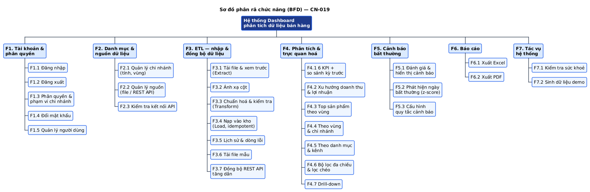

# Chương 4. CHỨC NĂNG CỐT LÕI & SƠ ĐỒ PHÂN RÃ CHỨC NĂNG (BFD)

## 4.1 Phương pháp xác định chức năng

Chức năng không liệt kê theo cảm tính mà **suy ra** theo chuỗi:

```
Đề bài ("Kết quả cần đạt") + Mục tiêu G1–G6 ─► Vấn đề P1–P8 ─► Quy trình TO-BE QT-01…QT-04
      ─► Mỗi BƯỚC hệ thống trong quy trình = 1 chức năng lá trong BFD
      ─► Gom nhóm theo đối tượng nghiệp vụ ─► Gắn MoSCoW + sprint
```

**Tiêu chí để một chức năng là "cốt lõi" (Must):** thoả **ít nhất một**:

1. Đề bài yêu cầu trực tiếp trong mục "Kết quả cần đạt".
2. Thiếu nó thì **luồng chính** "có dữ liệu nguồn → thấy dashboard đúng" bị đứt.
3. Thiếu nó thì số liệu **sai** (vi phạm G2): chuẩn hoá, idempotent, chỉ tính đơn hoàn tất.

## 4.2 Sơ đồ phân rã chức năng



_Hình H8 — BFD 3 mức: hệ thống → 7 nhóm chức năng → 29 chức năng lá. F7.1, F7.2 là tác vụ hệ thống: **có trong BFD nhưng không là use case** vì không có tác nhân nào dùng chúng để đạt một mục tiêu nghiệp vụ._

> **BFD khác Use Case thế nào?** BFD trả lời "hệ thống **gồm những chức năng gì**" (cấu trúc, không có tác nhân). Use case trả lời "**ai** dùng hệ thống **để đạt mục tiêu gì**". Vì vậy F3.3 "Chuẩn hoá & kiểm tra từng dòng" có trong BFD nhưng không là use case riêng: không ai mở hệ thống với mục tiêu "chuẩn hoá dữ liệu", đó là một bước bên trong UC06.

## 4.3 Bảng chức năng chi tiết

Cột **Sprint** tham chiếu bước trong `ke-hoach.md` §7.

### F1. Tài khoản & phân quyền

| Mã   | Chức năng                      | Mô tả ngắn                                             | Ưu tiên | UC   | FR           | Sprint     |
| ---- | ------------------------------ | ------------------------------------------------------ | ------- | ---- | ------------ | ---------- |
| F1.1 | Đăng nhập                      | Email + mật khẩu → cookie JWT httpOnly                 | Must    | UC01 | FR-01, FR-03 | S2.3, S2.4 |
| F1.2 | Đăng xuất                      | Xoá cookie                                             | Must    | UC02 | FR-02        | S2.3, S2.4 |
| F1.3 | Phân quyền & phạm vi chi nhánh | Kiểm tra vai trò, ép phạm vi chi nhánh cho manager     | Must    | —    | FR-06        | S2.3       |
| F1.4 | Đổi mật khẩu                   | Cần mật khẩu hiện tại                                  | Should  | UC03 | FR-04        | S6.1       |
| F1.5 | Quản lý người dùng             | Thêm, đổi vai trò/chi nhánh, khoá/mở, đặt lại mật khẩu | Should  | UC04 | FR-05        | S6.1       |

### F2. Danh mục & nguồn dữ liệu

| Mã   | Chức năng            | Mô tả ngắn                           | Ưu tiên | UC   | FR    | Sprint |
| ---- | -------------------- | ------------------------------------ | ------- | ---- | ----- | ------ |
| F2.1 | Quản lý chi nhánh    | Mã, tên, tỉnh, vùng                  | Should  | UC05 | FR-07 | S6.1   |
| F2.2 | Quản lý nguồn        | Nguồn file / nguồn API (URL, key ẩn) | Must    | UC10 | FR-15 | S5.3   |
| F2.3 | Kiểm tra kết nối API | Timeout 10 s, báo lỗi tiếng Việt     | Should  | UC10 | FR-16 | S5.3   |

### F3. ETL — nhập & đồng bộ dữ liệu

| Mã   | Chức năng                        | Mô tả ngắn                                             | Ưu tiên | UC   | FR           | Sprint     |
| ---- | -------------------------------- | ------------------------------------------------------ | ------- | ---- | ------------ | ---------- |
| F3.1 | Tải file & xem trước (Extract)   | Kiểm tra file, đọc cột + 10 dòng                       | Must    | UC06 | FR-08        | S3.1       |
| F3.2 | Ánh xạ cột                       | Gợi ý theo từ điển, sửa bằng dropdown                  | Must    | UC07 | FR-09        | S3.1, S3.3 |
| F3.3 | Chuẩn hoá & kiểm tra (Transform) | Từ điển §3.5 + BR-07…BR-12                             | Must    | UC06 | FR-10        | S3.2       |
| F3.4 | Nạp vào kho (Load)               | Transaction, idempotent theo đơn                       | Must    | UC06 | FR-11, FR-12 | S3.2       |
| F3.5 | Lịch sử & dòng lỗi               | Danh sách lần nhập, tải CSV lỗi                        | Must    | UC09 | FR-13        | S3.3       |
| F3.6 | Tải file mẫu                     | `mau-du-lieu.xlsx`                                     | Should  | UC08 | FR-14        | S3.3       |
| F3.7 | Đồng bộ REST API                 | Tăng dần, phân trang, chống chạy chồng; dùng F3.3–F3.4 | Must    | UC11 | FR-17, FR-18 | S5.3       |

### F4. Phân tích & trực quan hoá

| Mã   | Chức năng                  | Mô tả ngắn                                                  | Ưu tiên | UC   | FR           | Sprint     |
| ---- | -------------------------- | ----------------------------------------------------------- | ------- | ---- | ------------ | ---------- |
| F4.1 | KPI + so sánh kỳ trước     | 6 thẻ: doanh thu, lợi nhuận, biên LN, số đơn, AOV, giữ chân | Must    | UC12 | FR-19        | S4.1, S4.2 |
| F4.2 | Xu hướng                   | Doanh thu & lợi nhuận theo thời gian                        | Must    | UC12 | FR-20        | S4.1, S4.3 |
| F4.3 | Top sản phẩm theo vùng     | Thanh ngang + bảng, chọn vùng                               | Must    | UC12 | FR-21        | S4.1, S4.3 |
| F4.4 | Theo vùng & chi nhánh      | Cột doanh thu, lợi nhuận                                    | Must    | UC12 | FR-22        | S4.1, S4.3 |
| F4.5 | Theo danh mục & kênh       | Donut, cột                                                  | Must    | UC12 | FR-23        | S4.1, S4.3 |
| F4.6 | Bộ lọc đa chiều & lọc chéo | Thời gian, chi nhánh, danh mục, kênh; URL; click để lọc     | Must    | UC13 | FR-24, FR-25 | S4.2, S4.3 |
| F4.7 | Drill-down                 | Năm → quý → tháng → ngày; vùng → chi nhánh; danh mục → SP   | Must    | UC14 | FR-26, FR-27 | S4.1, S4.3 |

### F5. Cảnh báo · F6. Báo cáo · F7. Tác vụ hệ thống

| Mã   | Chức năng                    | Mô tả ngắn                            | Ưu tiên | UC   | FR    | Sprint |
| ---- | ---------------------------- | ------------------------------------- | ------- | ---- | ----- | ------ |
| F5.1 | Đánh giá & hiển thị cảnh báo | Quy tắc so kỳ trước, ngưỡng tuyệt đối | Must    | UC15 | FR-29 | S5.1   |
| F5.2 | Phát hiện ngày bất thường    | z-score so 28 ngày trước              | Should  | UC15 | FR-30 | S5.1   |
| F5.3 | Cấu hình quy tắc cảnh báo    | Bật/tắt, ngưỡng, mức                  | Should  | UC16 | FR-31 | S6.2   |
| F6.1 | Xuất Excel                   | 5 sheet theo bộ lọc                   | Must    | UC17 | FR-32 | S5.2   |
| F6.2 | Xuất PDF                     | Trang in A4 → lưu PDF                 | Must    | UC17 | FR-33 | S5.2   |
| F7.1 | Kiểm tra sức khoẻ            | `/api/health` + CSDL                  | Must    | —    | FR-34 | S1.2   |
| F7.2 | Sinh dữ liệu demo            | Seed ~100.000 dòng tái lập được       | Must    | —    | FR-35 | S1.4   |

**Thống kê:** 29 chức năng lá — **Must 22** · **Should 7**.

## 4.4 Bộ chức năng tối thiểu chạy được (MVP) và thứ tự phụ thuộc

Nếu chỉ còn thời gian cho phần Must, hệ thống vẫn phải demo được **luồng xuyên suốt**:

```
 F7.1 health ─► F1.1 đăng nhập ─► F3.1 tải file ─► F3.2 ánh xạ ─► F3.3 chuẩn hoá ─► F3.4 nạp kho
                                                                                    │
  F6.1/F6.2 xuất ◄── F5.1 cảnh báo ◄── F4.6/F4.7 lọc, drill ◄── F4.1–F4.5 dashboard ◄┘
```

**Phụ thuộc giữa các nhóm** (đọc là "A cần B có trước"):

| Nhóm                   | Phụ thuộc vào                                | Vì sao                                                       |
| ---------------------- | -------------------------------------------- | ------------------------------------------------------------ |
| F3 ETL                 | Kho hình sao (S1.3), F1 (người tạo lần nhập) | `import_jobs.created_by` cần user; Load ghi vào `fact_sales` |
| F3.7 Đồng bộ API       | F3.3, F3.4                                   | Không viết pipeline thứ hai, chỉ thêm extractor              |
| F4 Phân tích           | F3.4 **hoặc** dữ liệu seed F7.2              | Sprint 4 làm song song được nhờ seed                         |
| F5 Cảnh báo            | F4.1 (dùng lại hàm tính KPI + kỳ trước)      | Cảnh báo phải khớp số trên thẻ KPI                           |
| F6 Xuất báo cáo        | F4 (dùng lại câu truy vấn), F5               | Số liệu xuất phải **khớp** dashboard                         |
| F1.3 Phạm vi chi nhánh | Bảng `dim_branch`, `users.branch_key`        | Có từ migration đầu (S1.3)                                   |
