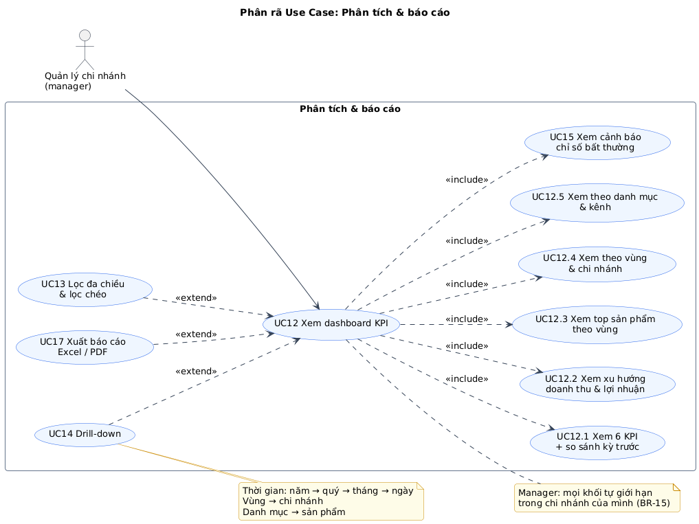

# Chương 5. TÁC NHÂN & USE CASE TỔNG QUÁT

## 5.1 Tác nhân (Actors)

| Mã  | Tác nhân                            | Loại             | Là ai trong thực tế                      | Mục tiêu khi dùng hệ thống                                                       | Thiết bị chính                        |
| --- | ----------------------------------- | ---------------- | ---------------------------------------- | -------------------------------------------------------------------------------- | ------------------------------------- |
| A1  | **Quản trị viên** (`admin`)         | Chính (người)    | Giám đốc / chủ doanh nghiệp              | Xem toàn chuỗi; kiểm soát ai xem gì; khai báo chi nhánh, nguồn, quy tắc cảnh báo | Máy tính (cấu hình), điện thoại (xem) |
| A2  | **Nhân viên phân tích** (`analyst`) | Chính (người)    | Nhân viên văn phòng, kế toán             | Đưa dữ liệu vào nhanh và đúng; xem, xuất báo cáo toàn chuỗi                      | Máy tính                              |
| A3  | **Quản lý chi nhánh** (`manager`)   | Chính (người)    | Cửa hàng trưởng                          | Theo dõi KPI, sản phẩm, cảnh báo **của chi nhánh mình**; xuất báo cáo chi nhánh  | Điện thoại, máy tính                  |
| A4  | **Hệ thống nguồn API**              | Phụ (supporting) | Website bán hàng (demo: `mock-shop-api`) | Trả dữ liệu đơn khi được gọi; không chủ động gọi vào hệ thống                    | -                                     |

> **Vì sao "Hệ thống nguồn API" là tác nhân phụ?** Nó nằm ngoài ranh giới hệ thống và tham gia UC10 (kiểm tra kết nối), UC11 (đồng bộ), nhưng không khởi phát và không hưởng lợi. Trong sơ đồ, đường nối đi **từ use case tới tác nhân phụ**.
>
> **Vì sao không còn "Bộ lập lịch"?** Đồng bộ theo lịch nằm ngoài phạm vi (§3.1.7). Đồng bộ do người bấm nên tác nhân khởi phát là analyst.

### 5.1.1 Phân cấp tác nhân


_Hình H9b - Tổng quát hoá tác nhân: `admin` kế thừa `analyst`, `analyst` kế thừa `manager`._

Ý nghĩa: tác nhân con thực hiện được **mọi** use case của tác nhân cha. Sơ đồ tổng quát chỉ cần nối mỗi use case với **tác nhân thấp nhất được phép**.

**Ánh xạ xuống code** - thứ bậc `manager < analyst < admin`:

```ts
const RANK = { manager: 1, analyst: 2, admin: 3 } as const;
export const requireRole = (min: keyof typeof RANK) => (req, res, next) =>
  RANK[req.user.role] >= RANK[min]
    ? next()
    : res.status(403).json({ message: "Bạn không có quyền thực hiện thao tác này" });
```

**Ngoại lệ không theo thứ bậc** (kiểm tra riêng, không chỉ bằng `requireRole`):

- **Phạm vi dữ liệu** (BR-15): kế thừa use case **không** có nghĩa là kế thừa phạm vi. Manager làm được UC12 "Xem dashboard" nhưng chỉ trên chi nhánh của mình; analyst/admin làm UC12 trên toàn chuỗi. Middleware `applyBranchScope` chạy **sau** `requireAuth`, **trước** validate query.
- UC04: admin không tự khoá/hạ quyền mình; không để còn 0 admin đang hoạt động.

## 5.2 Danh sách Use Case

| Mã   | Use case                       | Tác nhân chính | Tác nhân phụ | Mục tiêu (1 câu)                                             | Ưu tiên | FR                         |
| ---- | ------------------------------ | -------------- | ------------ | ------------------------------------------------------------ | ------- | -------------------------- |
| UC01 | Đăng nhập                      | Manager (+)    | -            | Vào hệ thống với đúng quyền và phạm vi của mình              | Must    | FR-01, FR-03               |
| UC02 | Đăng xuất                      | Manager (+)    | -            | Kết thúc phiên trên thiết bị dùng chung                      | Must    | FR-02                      |
| UC03 | Đổi mật khẩu                   | Manager (+)    | -            | Bảo vệ tài khoản                                             | Should  | FR-04                      |
| UC04 | Quản lý người dùng             | Admin          | -            | Cấp/thu hồi quyền, gán chi nhánh cho quản lý                 | Should  | FR-05                      |
| UC05 | Quản lý chi nhánh              | Admin          | -            | Khai báo chi nhánh và vùng miền để phân tích theo vùng       | Should  | FR-07                      |
| UC06 | Nhập dữ liệu từ file           | Analyst (+)    | -            | Đưa đơn hàng từ file vào kho, biết dòng nào lỗi              | Must    | FR-08, FR-10, FR-11, FR-12 |
| UC07 | Ánh xạ cột                     | Analyst (+)    | -            | Cho hệ thống biết cột nào của file là trường nào             | Must    | FR-09                      |
| UC08 | Tải file mẫu                   | Analyst (+)    | -            | Có file đúng cấu trúc khi chưa có file xuất sẵn              | Should  | FR-14                      |
| UC09 | Xem lịch sử & lỗi nhập         | Analyst (+)    | -            | Kiểm tra các lần nhập, lấy dòng lỗi để sửa                   | Must    | FR-13                      |
| UC10 | Quản lý nguồn dữ liệu          | Admin          | Nguồn API    | Khai báo nguồn file/API, kiểm tra kết nối                    | Must    | FR-15, FR-16               |
| UC11 | Đồng bộ dữ liệu từ API         | Analyst (+)    | Nguồn API    | Lấy đơn mới từ website vào kho                               | Must    | FR-17, FR-18               |
| UC12 | Xem dashboard KPI              | Manager (+)    | -            | Nắm tình hình kinh doanh qua KPI và biểu đồ                  | Must    | FR-19…FR-23, FR-28         |
| UC13 | Lọc đa chiều & lọc chéo        | Manager (+)    | -            | Xem theo thời gian/chi nhánh/danh mục/kênh, chia sẻ góc nhìn | Must    | FR-24, FR-25               |
| UC14 | Drill-down                     | Manager (+)    | -            | Đi từ tổng quan xuống chi tiết để tìm nguyên nhân            | Must    | FR-26, FR-27               |
| UC15 | Xem cảnh báo chỉ số bất thường | Manager (+)    | -            | Biết ngay chỉ số nào đang xấu đi                             | Must    | FR-29, FR-30               |
| UC16 | Cấu hình quy tắc cảnh báo      | Admin          | -            | Đặt ngưỡng cảnh báo phù hợp doanh nghiệp                     | Should  | FR-31                      |
| UC17 | Xuất báo cáo Excel/PDF         | Manager (+)    | -            | Mang báo cáo theo bộ lọc đi họp, lưu trữ                     | Must    | FR-32, FR-33               |

**Thống kê:** 17 use case - Must 12 (UC01, 02, 06, 07, 09, 10, 11, 12, 13, 14, 15, 17) · Should 5 (UC03, 04, 05, 08, 16).

## 5.3 Sơ đồ Use Case tổng quát


_Hình H9 - Use case tổng quát. Đọc kèm Hình H9b (phân cấp tác nhân) và ma trận §5.4._

| Quan hệ               | Ý nghĩa                                                        | Vì sao chọn                                                                 |
| --------------------- | -------------------------------------------------------------- | --------------------------------------------------------------------------- |
| UC06 `«include»` UC07 | Nhập file **luôn** có bước ánh xạ cột                          | Không có thì không biết cột nào là mã đơn                                   |
| UC08 `«extend»` UC06  | Tải file mẫu là **tuỳ chọn**, chỉ khi chưa có file             | Có điều kiện                                                                |
| UC12 `«include»` UC15 | Mở dashboard **luôn** đánh giá và hiển thị cảnh báo            | Mục tiêu "biết sớm bất thường" (G5) không được phụ thuộc người dùng nhớ bấm |
| UC13 `«extend»` UC12  | Đổi bộ lọc là tuỳ chọn; dashboard vẫn hiện với bộ lọc mặc định | Không đổi lọc vẫn đạt mục tiêu của UC12                                     |
| UC14 `«extend»` UC12  | Drill-down là thao tác thêm khi đang xem                       | Có điều kiện (người dùng chủ động click)                                    |
| UC17 `«extend»` UC12  | Xuất báo cáo là thao tác thêm, dùng đúng bộ lọc đang xem       | Có điều kiện                                                                |

**Cố ý KHÔNG vẽ** (để trả lời khi bị hỏi):

- **Không** `«include» UC01 Đăng nhập` từ mọi use case: đăng nhập là **tiền điều kiện**, không phải một phần hành vi.
- **Không** có use case "Chuẩn hoá dữ liệu", "Nạp kho", "Kiểm tra sức khoẻ": là bước nội bộ/tác vụ hệ thống (có trong BFD).
- **Không** có use case "Xem biểu đồ top sản phẩm" ở mức tổng quát: là chi tiết của UC12, xuất hiện ở sơ đồ phân rã H12.

## 5.4 Ma trận phân quyền

### 5.4.1 Theo use case

| Use case                                                 |        Manager         |                  Analyst                  |   Admin    | Ghi chú                                       |
| -------------------------------------------------------- | :--------------------: | :---------------------------------------: | :--------: | --------------------------------------------- |
| UC01-UC03 Đăng nhập, đăng xuất, đổi mật khẩu             |           Có           |                    Có                     |     Có     | Chỉ đổi mật khẩu của chính mình               |
| UC12-UC15 Dashboard, lọc, drill-down, cảnh báo           | Có, **chi nhánh mình** |                Có, tất cả                 | Có, tất cả | BR-15                                         |
| UC17 Xuất báo cáo                                        | Có, **chi nhánh mình** |                Có, tất cả                 | Có, tất cả | Báo cáo chỉ chứa số liệu tổng hợp             |
| UC06-UC09 Nhập file, ánh xạ, file mẫu, lịch sử           |         Không          |                    Có                     |     Có     | Analyst xem lịch sử của mọi người để phối hợp |
| UC11 Đồng bộ API                                         |         Không          |                    Có                     |     Có     | Chỉ kích hoạt, không xem/sửa cấu hình         |
| UC10 Quản lý nguồn                                       |         Không          | Không (chỉ xem danh sách, không thấy key) |     Có     | API key là bí mật                             |
| UC04, UC05, UC16 Người dùng, chi nhánh, quy tắc cảnh báo |         Không          |                   Không                   |     Có     |                                               |

### 5.4.2 Theo API (dùng để viết test phân quyền NFR-05)

Quy ước: `public` = không cần đăng nhập; `manager+` = đăng nhập với vai trò bất kỳ; `analyst+` = analyst hoặc admin. `(phạm vi)` = áp dụng phạm vi chi nhánh BR-15.

| Method & đường dẫn                                                                                   | Quyền tối thiểu | UC         |
| ---------------------------------------------------------------------------------------------------- | --------------- | ---------- |
| `GET /api/health`                                                                                    | public          | -          |
| `POST /api/auth/login`                                                                               | public          | UC01       |
| `POST /api/auth/logout` · `GET /api/auth/me`                                                         | manager+        | UC01, UC02 |
| `PATCH /api/auth/password`                                                                           | manager+        | UC03       |
| `GET /api/users` · `POST /api/users` · `PATCH /api/users/:id` · `POST /api/users/:id/reset-password` | admin           | UC04       |
| `GET /api/branches`                                                                                  | manager+        | UC13       |
| `POST /api/branches` · `PATCH /api/branches/:id`                                                     | admin           | UC05       |
| `GET /api/imports/template`                                                                          | analyst+        | UC08       |
| `POST /api/imports/preview` · `POST /api/imports`                                                    | analyst+        | UC06, UC07 |
| `GET /api/imports` · `GET /api/imports/:id` · `GET /api/imports/:id/errors.csv`                      | analyst+        | UC09       |
| `GET /api/sources` (không có API key)                                                                | analyst+        | UC10, UC11 |
| `POST /api/sources` · `PATCH /api/sources/:id` · `POST /api/sources/:id/test`                        | admin           | UC10       |
| `POST /api/sources/:id/sync` → `200` / `409 đang đồng bộ`                                            | analyst+        | UC11       |
| `GET /api/analytics/summary\|trend\|top-products\|by-region\|by-category\|by-channel` (phạm vi)      | manager+        | UC12-UC14  |
| `GET /api/catalog/categories` · `GET /api/catalog/channels`                                          | manager+        | UC13       |
| `GET /api/alerts` (phạm vi)                                                                          | manager+        | UC15       |
| `GET /api/alert-rules` · `PATCH /api/alert-rules/:id`                                                | admin           | UC16       |
| `GET /api/reports/excel` (phạm vi)                                                                   | manager+        | UC17       |

> **Thiết kế:** trang PDF (`/report`) là trang web gọi lại các API phân tích `(phạm vi)`, nên không cần endpoint riêng và tự động đúng phạm vi chi nhánh.

## 5.5 Sơ đồ Use Case phân rã

### 5.5.1 Tài khoản & quản trị


_Hình H10 - UC04 phân rã: xem danh sách là `«include»` (vào màn hình là thấy); thêm, sửa vai trò/chi nhánh, khoá/mở, đặt lại mật khẩu là `«extend»`._

### 5.5.2 Quản lý dữ liệu (ETL)


_Hình H11 - UC06 gồm 3 bước bắt buộc: tải file & xem trước → ánh xạ cột (UC07) → xem kết quả. UC11 đồng bộ API dùng chung bước chuẩn hoá & nạp kho với UC06._

### 5.5.3 Phân tích & báo cáo



_Hình H12 - UC12 gồm 6 khối hiển thị bắt buộc và luôn kèm cảnh báo (UC15). Lọc (UC13), drill-down (UC14), xuất báo cáo (UC17) là tuỳ chọn (extend)._
