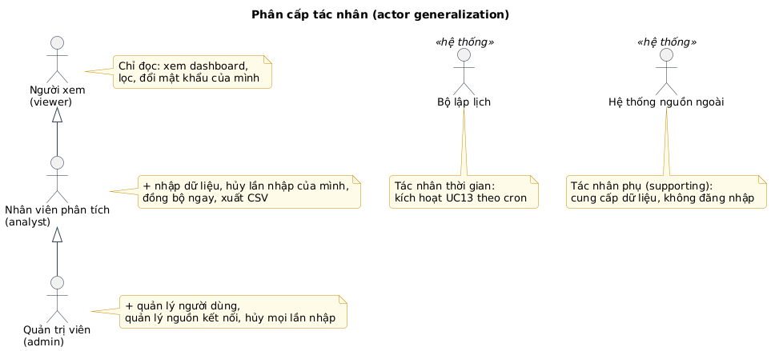
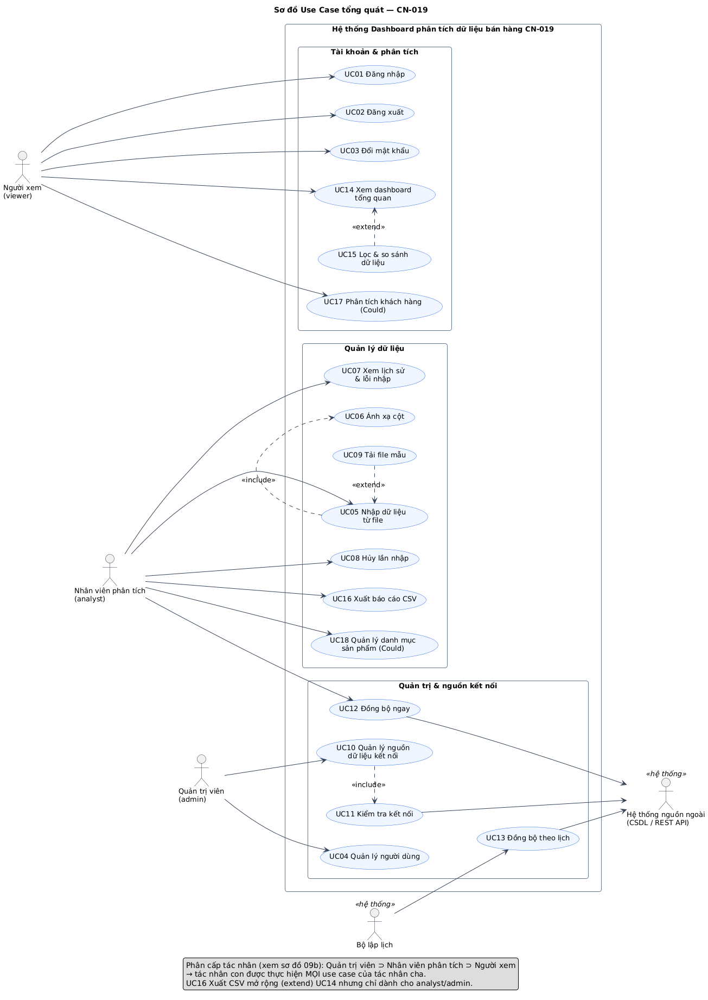
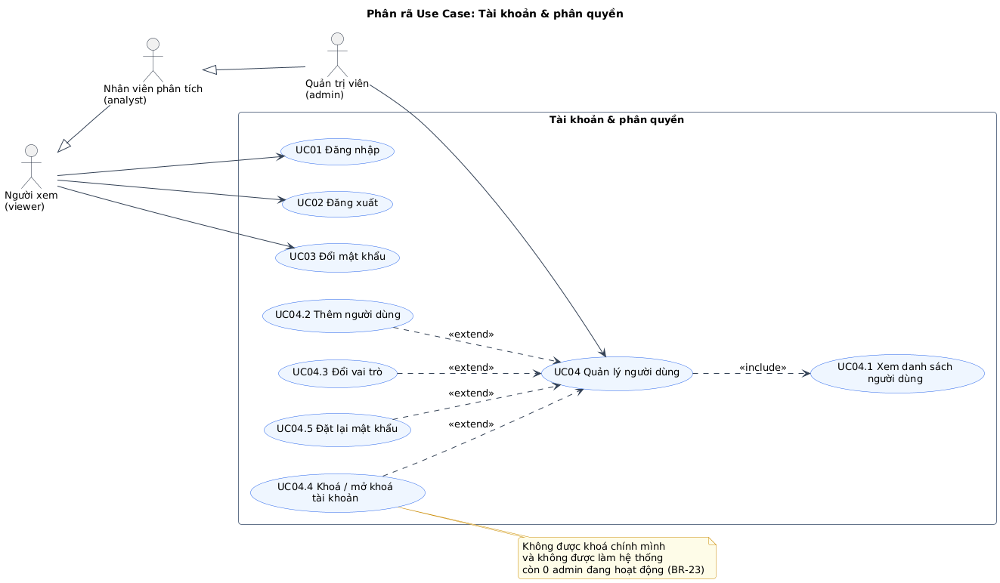
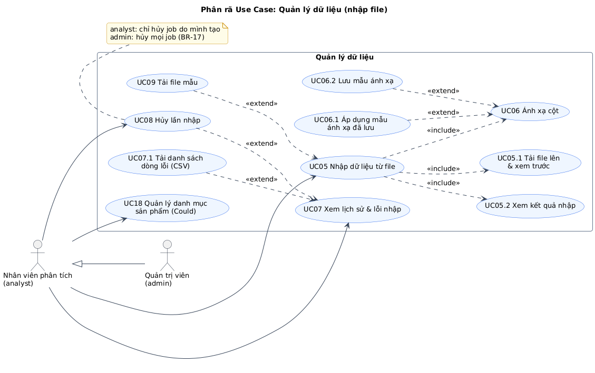
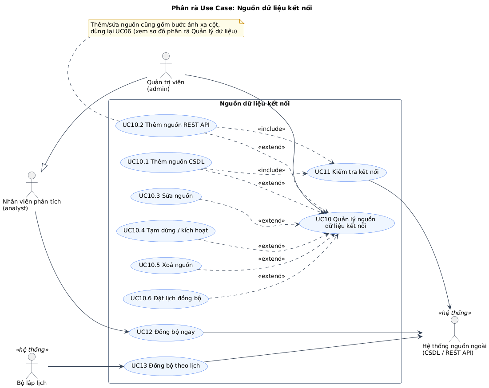
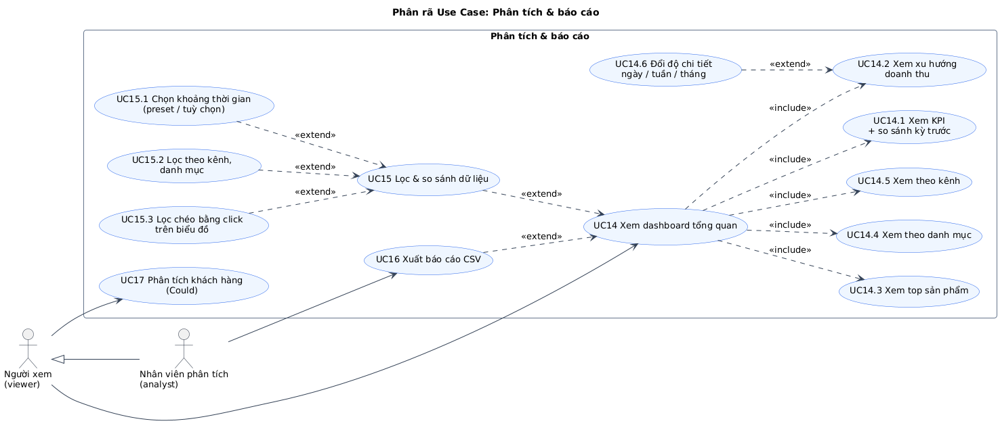

# Chương 5. TÁC NHÂN & USE CASE TỔNG QUÁT

## 5.1 Tác nhân (Actors)

| Mã  | Tác nhân                            | Loại              | Là ai trong thực tế                      | Mục tiêu khi dùng hệ thống                                               | Tần suất                           | Thiết bị chính                        |
| --- | ----------------------------------- | ----------------- | ---------------------------------------- | ------------------------------------------------------------------------ | ---------------------------------- | ------------------------------------- |
| A1  | **Quản trị viên** (`admin`)         | Chính (người)     | Chủ cửa hàng                             | Kiểm soát ai được xem/sửa; kết nối nguồn dữ liệu; xem kết quả kinh doanh | Hằng ngày xem, hằng tháng cấu hình | Điện thoại (xem), máy tính (cấu hình) |
| A2  | **Nhân viên phân tích** (`analyst`) | Chính (người)     | Nhân viên văn phòng, kế toán             | Đưa dữ liệu vào hệ thống nhanh và đúng; sửa khi nhập nhầm; xuất số liệu  | Hằng ngày                          | Máy tính                              |
| A3  | **Người xem** (`viewer`)            | Chính (người)     | Quản lý ca, cửa hàng trưởng, đối tác     | Theo dõi số liệu, **không** được thay đổi dữ liệu                        | Vài lần/tuần                       | Điện thoại                            |
| A4  | **Bộ lập lịch**                     | Chính (thời gian) | Tiến trình `node-cron` trong API         | Kích hoạt đồng bộ đúng giờ                                               | Theo lịch                          | —                                     |
| A5  | **Hệ thống nguồn ngoài**            | Phụ (supporting)  | CSDL bán hàng, REST API của cửa hàng/sàn | Cung cấp dữ liệu khi được gọi; không chủ động gọi vào hệ thống           | Khi đồng bộ                        | —                                     |

> **Vì sao "Bộ lập lịch" là tác nhân?** Tác nhân là thứ **nằm ngoài ranh giới hệ thống** và **khởi phát** một use case. UC13 không do người bấm mà do _thời gian_ khởi phát. UML gọi đây là tác nhân thời gian (time actor). Không có nó, UC13 sẽ thành use case "mồ côi" không ai kích hoạt, là lỗi hay bị GVHD bắt.
>
> **Vì sao "Hệ thống nguồn ngoài" là tác nhân phụ?** Nó tham gia use case (UC11–UC13) nhưng không phải bên được hưởng lợi hay khởi phát. Trong sơ đồ, mũi tên đi **từ use case tới tác nhân phụ**.

### 5.1.1 Phân cấp tác nhân



_Hình H9b — Tổng quát hoá tác nhân: `admin` kế thừa `analyst`, `analyst` kế thừa `viewer`._

Ý nghĩa: tác nhân con thực hiện được **mọi** use case của tác nhân cha. Nhờ vậy sơ đồ tổng quát chỉ cần nối mỗi use case với **tác nhân thấp nhất được phép**, không phải nối 3 đường cho UC14.

**Ánh xạ xuống code:** quan hệ kế thừa này chính là thứ tự cấp quyền `viewer < analyst < admin`. Middleware chỉ cần `requireRole('analyst')` hiểu là "analyst **trở lên**":

```ts
const RANK = { viewer: 1, analyst: 2, admin: 3 } as const;
export const requireRole = (min: keyof typeof RANK) => (req, res, next) =>
  RANK[req.user.role] >= RANK[min]
    ? next()
    : res.status(403).json({ message: "Bạn không có quyền thực hiện thao tác này" });
```

**Ngoại lệ không theo cấp bậc** (phải kiểm tra riêng trong service, không chỉ bằng `requireRole`):

- UC08 Hủy lần nhập: analyst chỉ hủy job **do mình tạo** (kiểm tra quyền sở hữu, ownership check).
- UC04: admin không tự khoá/hạ quyền mình; không để còn 0 admin (BR-23).

## 5.2 Danh sách Use Case

| Mã   | Use case                      | Tác nhân chính | Tác nhân phụ | Mục tiêu (1 câu)                                               | Ưu tiên | FR                         |
| ---- | ----------------------------- | -------------- | ------------ | -------------------------------------------------------------- | ------- | -------------------------- |
| UC01 | Đăng nhập                     | Viewer (+)     | —            | Vào hệ thống với đúng quyền của mình                           | Must    | FR-01, FR-03               |
| UC02 | Đăng xuất                     | Viewer (+)     | —            | Kết thúc phiên trên thiết bị dùng chung                        | Must    | FR-02                      |
| UC03 | Đổi mật khẩu                  | Viewer (+)     | —            | Bảo vệ tài khoản; đổi mật khẩu tạm                             | Should  | FR-04, FR-08               |
| UC04 | Quản lý người dùng            | Admin          | —            | Cấp/thu hồi quyền cho nhân viên                                | Should  | FR-05…FR-08                |
| UC05 | Nhập dữ liệu từ file          | Analyst (+)    | —            | Đưa đơn hàng từ file vào hệ thống, biết dòng nào lỗi           | Must    | FR-10, FR-11, FR-15…FR-19  |
| UC06 | Ánh xạ cột                    | Analyst (+)    | —            | Cho hệ thống biết cột nào là gì (bước bắt buộc của UC05, UC10) | Must    | FR-12…FR-14                |
| UC07 | Xem lịch sử & lỗi nhập        | Analyst (+)    | —            | Kiểm tra các lần nhập, lấy danh sách dòng lỗi để sửa           | Must    | FR-16, FR-20, FR-21        |
| UC08 | Hủy lần nhập                  | Analyst (+)    | —            | Gỡ dữ liệu của một lần nhập nhầm                               | Should  | FR-22                      |
| UC09 | Tải file mẫu                  | Analyst (+)    | —            | Có file đúng cấu trúc khi chưa có nguồn xuất sẵn               | Should  | FR-23                      |
| UC10 | Quản lý nguồn dữ liệu kết nối | Admin          | —            | Khai báo, sửa, tạm dừng, xoá, đặt lịch cho nguồn CSDL/API      | Should  | FR-24, FR-25, FR-28, FR-29 |
| UC11 | Kiểm tra kết nối              | Admin          | Nguồn ngoài  | Chắc chắn thông tin kết nối đúng trước khi lưu                 | Should  | FR-26                      |
| UC12 | Đồng bộ ngay                  | Analyst (+)    | Nguồn ngoài  | Lấy dữ liệu mới nhất ngay, không chờ lịch                      | Should  | FR-27                      |
| UC13 | Đồng bộ theo lịch             | Bộ lập lịch    | Nguồn ngoài  | Dữ liệu tự cập nhật không cần người                            | Should  | FR-28                      |
| UC14 | Xem dashboard tổng quan       | Viewer (+)     | —            | Nắm tình hình kinh doanh qua KPI và biểu đồ                    | Must    | FR-30…FR-34, FR-39         |
| UC15 | Lọc & so sánh dữ liệu         | Viewer (+)     | —            | Xem theo thời gian/kênh/danh mục, chia sẻ góc nhìn             | Must    | FR-35…FR-38, FR-43         |
| UC16 | Xuất báo cáo CSV              | Analyst (+)    | —            | Mang số liệu tổng hợp ra Excel                                 | Should  | FR-40                      |
| UC17 | Phân tích khách hàng          | Viewer (+)     | —            | Biết tỉ lệ khách quay lại, nhóm khách giá trị                  | Could   | FR-41                      |
| UC18 | Quản lý danh mục sản phẩm     | Analyst (+)    | —            | Sửa tên sản phẩm, gán danh mục cho đúng                        | Could   | FR-42                      |

**Thống kê:** 18 use case — Must 7 (UC01, 02, 05, 06, 07, 14, 15) · Should 9 · Could 2.

## 5.3 Sơ đồ Use Case tổng quát



_Hình H9 — Use case tổng quát. Đọc kèm Hình H9b (phân cấp tác nhân) và ma trận §5.4._

**Giải thích các quan hệ:**

| Quan hệ               | Ý nghĩa                                                             | Vì sao chọn                                                                                                |
| --------------------- | ------------------------------------------------------------------- | ---------------------------------------------------------------------------------------------------------- |
| UC05 `«include»` UC06 | Nhập file **luôn luôn** có bước ánh xạ cột                          | Bắt buộc, không có thì không biết cột nào là mã đơn. UC06 cũng được UC10 dùng lại → tách ra để tái sử dụng |
| UC09 `«extend»` UC05  | Tải file mẫu là **tuỳ chọn**, chỉ khi người dùng chưa có file       | Có điều kiện, không bắt buộc                                                                               |
| UC15 `«extend»` UC14  | Đổi bộ lọc là tuỳ chọn; dashboard vẫn hiển thị với bộ lọc mặc định  | Không đổi lọc vẫn đạt mục tiêu của UC14                                                                    |
| UC16 `«extend»` UC14  | Xuất CSV là thao tác thêm khi đang xem dashboard                    | Có điều kiện (quyền analyst+, người dùng chủ động bấm)                                                     |
| UC10 `«include»` UC11 | Thêm/sửa nguồn **bắt buộc** kiểm tra kết nối thành công mới cho lưu | Tránh lưu nguồn sai rồi job theo lịch thất bại âm thầm                                                     |

**Những thứ cố ý KHÔNG vẽ** (và lý do, để trả lời khi bị hỏi):

- **Không** vẽ `«include» UC01 Đăng nhập` từ mọi use case. Đăng nhập là **tiền điều kiện**, không phải một phần hành vi của use case khác. Ghi ở mục "Tiền điều kiện" trong đặc tả.
- **Không** có use case "Chuẩn hoá dữ liệu", "Làm mới MV", "Kiểm tra sức khoẻ": đây là bước nội bộ/tác vụ nền, không phải mục tiêu của tác nhân (đã có trong BFD).
- **Không** có use case "Xem biểu đồ top sản phẩm" ở mức tổng quát: đó là chi tiết của UC14, chỉ xuất hiện ở sơ đồ phân rã H13.

## 5.4 Ma trận phân quyền

### 5.4.1 Theo use case

| Use case                                     | Viewer |        Analyst         |   Admin    | Ghi chú                                         |
| -------------------------------------------- | :----: | :--------------------: | :--------: | ----------------------------------------------- |
| UC01–UC03 Đăng nhập, đăng xuất, đổi mật khẩu |   ✅   |           ✅           |     ✅     | Chỉ đổi mật khẩu của chính mình                 |
| UC14, UC15 Dashboard, lọc                    |   ✅   |           ✅           |     ✅     |                                                 |
| UC17 Phân tích khách hàng (Could)            |   ✅   |           ✅           |     ✅     | Chỉ số liệu tổng hợp                            |
| UC16 Xuất CSV                                |   ❌   |           ✅           |     ✅     | Viewer không mang dữ liệu ra ngoài (P8)         |
| UC05, UC06, UC09 Nhập file, ánh xạ, file mẫu |   ❌   |           ✅           |     ✅     |                                                 |
| UC07 Xem lịch sử nhập                        |   ❌   |      ✅ (mọi job)      |     ✅     | Analyst xem được job của người khác để phối hợp |
| UC08 Hủy lần nhập                            |   ❌   |    ⚠️ job của mình     | ✅ mọi job | Kiểm tra sở hữu (ownership)                     |
| UC12 Đồng bộ ngay                            |   ❌   |           ✅           |     ✅     | Chỉ kích hoạt, không xem/sửa cấu hình           |
| UC18 Danh mục sản phẩm (Could)               |   ❌   |           ✅           |     ✅     |                                                 |
| UC10, UC11 Quản lý nguồn, kiểm tra kết nối   |   ❌   | ❌ (chỉ xem danh sách) |     ✅     | Cấu hình chứa thông tin đăng nhập CSDL          |
| UC04 Quản lý người dùng                      |   ❌   |           ❌           |     ✅     | BR-23                                           |

### 5.4.2 Theo API (dùng để viết test phân quyền NFR-06)

Quy ước: `public` = không cần đăng nhập; `viewer+` = đăng nhập với vai trò bất kỳ; `analyst+` = analyst hoặc admin.

| Method & đường dẫn                                                                                          | Quyền tối thiểu                               | UC         | Bước KH |
| ----------------------------------------------------------------------------------------------------------- | --------------------------------------------- | ---------- | ------- |
| `GET /api/health`                                                                                           | public                                        | —          | B1.4    |
| `POST /api/auth/login`                                                                                      | public                                        | UC01       | B2.2    |
| `POST /api/auth/logout`                                                                                     | viewer+                                       | UC02       | B2.2    |
| `GET /api/auth/me`                                                                                          | viewer+                                       | UC01       | B2.2    |
| `PATCH /api/auth/password`                                                                                  | viewer+                                       | UC03       | B4.8 🆕 |
| `GET /api/users` · `POST /api/users`                                                                        | admin                                         | UC04       | B4.8 🆕 |
| `PATCH /api/users/:id` (họ tên, vai trò, khoá/mở)                                                           | admin                                         | UC04       | B4.8 🆕 |
| `POST /api/users/:id/reset-password`                                                                        | admin                                         | UC04       | B4.8 🆕 |
| `GET /api/imports/template`                                                                                 | analyst+                                      | UC09       | B2.7    |
| `POST /api/imports/preview`                                                                                 | analyst+                                      | UC05       | B2.4    |
| `POST /api/imports` → `202 { jobId }`                                                                       | analyst+                                      | UC05       | B2.5    |
| `GET /api/imports` · `GET /api/imports/:id`                                                                 | analyst+                                      | UC05, UC07 | B2.7    |
| `GET /api/imports/:id/errors[?format=csv]`                                                                  | analyst+                                      | UC07       | B2.7    |
| `GET /api/imports/:id/undo-preview` · `POST /api/imports/:id/undo`                                          | analyst+ **và** (là người tạo **hoặc** admin) | UC08       | B3.7 🆕 |
| `GET/POST /api/mapping-templates` · `PUT/DELETE /api/mapping-templates/:id`                                 | analyst+                                      | UC06       | B2.7    |
| `GET /api/sources` · `GET /api/sources/:id` (không có bí mật)                                               | analyst+                                      | UC10, UC12 | B4.1    |
| `POST /api/sources` · `PATCH/DELETE /api/sources/:id`                                                       | admin                                         | UC10       | B4.1    |
| `POST /api/sources/test` (chưa lưu) · `POST /api/sources/:id/test`                                          | admin                                         | UC11       | B4.2    |
| `POST /api/sources/:id/sync` → `202` / `409 đang đồng bộ`                                                   | analyst+                                      | UC12       | B4.2    |
| `GET /api/analytics/summary\|revenue-trend\|top-products\|by-category\|by-channel`                          | viewer+                                       | UC14, UC15 | B3.2    |
| `GET /api/analytics/customers` (Could)                                                                      | viewer+                                       | UC17       | —       |
| `GET /api/catalog/channels` · `GET /api/catalog/categories`                                                 | viewer+                                       | UC15       | B3.5    |
| `GET /api/catalog/products` · `PATCH /api/catalog/products/:id` · `PATCH /api/catalog/channels/:id` (Could) | analyst+                                      | UC18       | —       |
| `GET /api/export/csv?report=daily\|products\|categories\|channels&…`                                        | analyst+                                      | UC16       | B4.6    |

> **Lưu ý thiết kế:** mẫu ánh xạ của file được lưu trong `data_sources` (`type IN ('csv','excel')`) như `ke-hoach.md` đã định, nhưng đi qua endpoint riêng `/api/mapping-templates` (analyst+) để tách quyền với nguồn kết nối `type IN ('database','api')` (admin). Nếu dùng chung `/api/sources` thì hoặc analyst sửa được nguồn CSDL (sai quyền), hoặc analyst không lưu được mẫu (sai nghiệp vụ).

## 5.5 Sơ đồ Use Case phân rã

### 5.5.1 Tài khoản & phân quyền



_Hình H10 — UC04 phân rã thành 5 use case con. Xem danh sách là `«include»` (vào màn hình là thấy danh sách); thêm/sửa/khoá/đặt lại là `«extend»` (tuỳ người dùng chọn)._

### 5.5.2 Quản lý dữ liệu (nhập file)



_Hình H11 — UC05 bao gồm (include) 3 bước bắt buộc: tải file & xem trước → ánh xạ cột → xem kết quả. Hủy lần nhập (UC08) mở rộng (extend) màn hình lịch sử UC07 vì được thực hiện từ đó._

### 5.5.3 Nguồn dữ liệu kết nối



_Hình H12 — Thêm nguồn (CSDL/REST) bắt buộc kiểm tra kết nối (include UC11). Đồng bộ ngay (analyst) và đồng bộ theo lịch (Bộ lập lịch) là hai use case riêng vì **tác nhân khác nhau** và hành vi khi đụng khoá khác nhau (báo lỗi 409 vs bỏ qua im lặng)._

### 5.5.4 Phân tích & báo cáo



_Hình H13 — UC14 gồm 5 khối hiển thị bắt buộc (include). Lọc (UC15) và các kiểu lọc con là tuỳ chọn (extend)._
