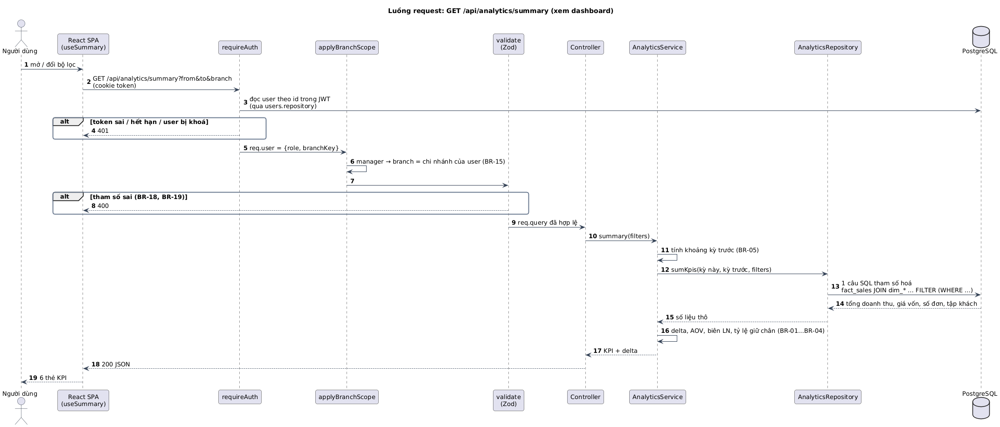
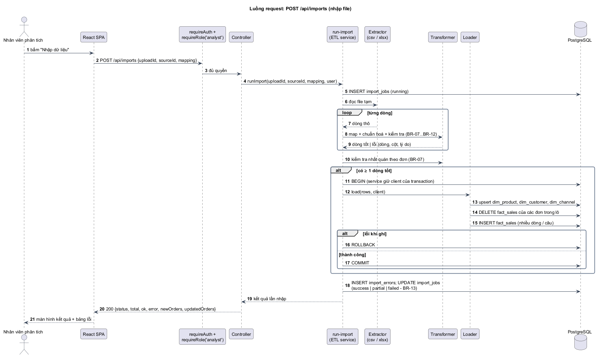
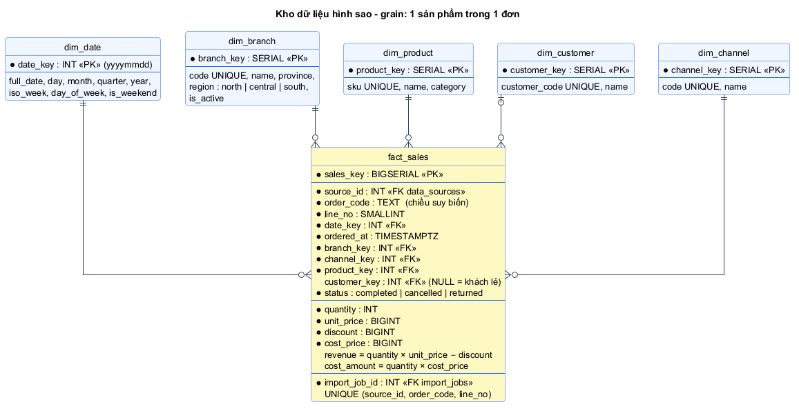

# Chương 8. KIẾN TRÚC, CÔNG NGHỆ & ĐỊNH HƯỚNG PHÁT TRIỂN

> **Phạm vi:** phiên bản **đơn giản nhất đủ yêu cầu đề tài** - một web app 3 tầng, một server API, một CSDL. Mục tiêu là nắm chắc các quy tắc nền của một hệ thống web trước khi mở rộng.
> Chương này là **nguồn sự thật duy nhất** cho: kiến trúc, quy tắc phân lớp, cấu trúc thư mục, mô hình dữ liệu, công nghệ. Chương 3 định nghĩa hệ thống làm _gì_; chương này định nghĩa hệ thống được _xây thế nào_.

## 8.1 Tổng quan: kiến trúc 3 tầng

```
┌──────────────────────┐   HTTPS + JSON    ┌─────────────────────────────┐   SQL (pg Pool)   ┌──────────────┐
│ TẦNG TRÌNH BÀY       │ ────────────────► │ TẦNG ỨNG DỤNG               │ ────────────────► │ TẦNG DỮ LIỆU │
│ React SPA (apps/web) │ ◄──────────────── │ Express API (apps/api)      │ ◄──────────────── │ PostgreSQL   │
│ chạy trên trình duyệt│  cookie JWT       │ phân quyền, nghiệp vụ, ETL  │                   │ kho hình sao │
└──────────────────────┘                   └──────────────┬──────────────┘                   └──────────────┘
                                                          │ HTTP (fetch)
                                              REST API nguồn (apps/mock-shop-api)
```

| Tầng      | Chạy ở đâu     | Được làm                                                         | Không được làm                                       |
| --------- | -------------- | ---------------------------------------------------------------- | ---------------------------------------------------- |
| Trình bày | Trình duyệt    | Hiển thị, giữ trạng thái bộ lọc, kiểm tra form để báo lỗi sớm    | Tin rằng mình là lớp bảo vệ; giữ bí mật; tự tính KPI |
| Ứng dụng  | Server Node.js | Xác thực, phân quyền, quy tắc nghiệp vụ, ETL, tính KPI           | Trả lỗi kỹ thuật thô (stack trace) cho client        |
| Dữ liệu   | Server CSDL    | Lưu trữ, ràng buộc toàn vẹn (PK, FK, CHECK, UNIQUE), gộp số liệu | Chứa logic hiển thị                                  |

> **Quy tắc vàng:** mọi thứ ở trình duyệt đều sửa được bằng DevTools. Vì vậy **kiểm tra dữ liệu và phân quyền phải làm lại ở server**; kiểm tra ở FE chỉ để báo lỗi nhanh cho người dùng (FR-06, NFR-05).

## 8.2 Kiến trúc phân lớp của backend

### 8.2.1 Các lớp và trách nhiệm

```
 HTTP request
   │
   ▼
 Route        routes.ts        khai báo method + path, gắn middleware, trỏ tới controller
   │
   ▼
 Middleware   middlewares/     việc chung cho nhiều route: requireAuth, requireRole,
   │                           applyBranchScope, validate(schema), upload file, xử lý lỗi
   ▼
 Controller   controller.ts    đọc req (đã validate) → gọi service → chọn mã HTTP + JSON trả về
   │
   ▼
 Service      service.ts       quy tắc nghiệp vụ (BR-xx), điều phối transaction; KHÔNG biết req/res
   │
   ▼
 Repository   repository.ts    nơi DUY NHẤT viết SQL; nhận tham số thuần, trả object thuần
   │
   ▼
 PostgreSQL
```

| Lớp        | Đầu vào → đầu ra                                                     | Được gọi                 | Không được                                                            | Vì sao tách                                                                  |
| ---------- | -------------------------------------------------------------------- | ------------------------ | --------------------------------------------------------------------- | ---------------------------------------------------------------------------- |
| Route      | URL → chuỗi middleware + controller                                  | Middleware, Controller   | Chứa logic                                                            | Nhìn 1 file là biết toàn bộ API và quyền của module                          |
| Middleware | `req` → `req` đã bổ sung (`req.user`, bộ lọc đã áp phạm vi) hoặc lỗi | -                        | Chứa quy tắc nghiệp vụ; tự viết SQL (đọc user qua `users.repository`) | Một chỗ duy nhất cho xác thực/phân quyền → không sót endpoint                |
| Controller | `req` → gọi service → `res.status().json()`                          | Service                  | Viết SQL; chứa quy tắc nghiệp vụ                                      | Đổi framework (Express → khác) chỉ sửa lớp này                               |
| Service    | tham số thuần → kết quả thuần / ném lỗi nghiệp vụ                    | Repository, service khác | Đọc `req`, `res`; viết SQL                                            | Test được bằng unit test không cần HTTP; dùng lại cho cảnh báo, xuất báo cáo |
| Repository | tham số thuần → dòng dữ liệu                                         | `pg` Pool / client       | Quy tắc nghiệp vụ; nối chuỗi vào SQL                                  | Mọi SQL ở một chỗ → tối ưu, đọc execution plan, chống SQL injection          |

**Quy tắc phụ thuộc:** chỉ gọi **xuống** lớp ngay dưới (hoặc cùng lớp ở module khác qua service). Không gọi ngược lên, không bỏ lớp (controller gọi thẳng repository). Hệ quả cụ thể trong đồ án:

- `alerts.service` và `reports.service` **gọi lại** `analytics.service` thay vì viết SQL riêng → số trên cảnh báo, file Excel và dashboard luôn khớp (AC-17.1).
- Đồng bộ API (UC11) và nhập file (UC06) **dùng chung** `etl/transformer` và `etl/loader`; chỉ khác extractor (NFR-13).
- Transaction mở ở **service** (biết khi nào một nghiệp vụ bắt đầu/kết thúc), truyền `client` xuống repository.

### 8.2.2 Module ETL

ETL là một service đặc biệt, chia theo 4 bước của §3.4:

| Bước      | File                               | Trách nhiệm                                                                                         |
| --------- | ---------------------------------- | --------------------------------------------------------------------------------------------------- |
| Extract   | `etl/extractors/{csv,xlsx,api}.ts` | Đọc nguồn, trả **async iterable** các dòng thô; không kiểm tra nghiệp vụ                            |
| Map       | `etl/mapper.ts`                    | Cột nguồn → 14 trường `ImportRow` (§3.5.1) theo ánh xạ                                              |
| Transform | `etl/transformer.ts`               | Chuẩn hoá + kiểm tra từng dòng (BR-07…BR-12), tách dòng tốt / dòng lỗi                              |
| Load      | `etl/loader.ts`                    | Trong transaction do `run-import` mở: upsert bảng chiều → xoá fact của các đơn trong lô → chèn fact |
| Điều phối | `etl/run-import.ts`                | Tạo lần nhập, nối 4 bước, mở/đóng transaction, ghi thống kê và trạng thái (BR-13)                   |

Thêm nguồn mới (vd. CSDL ngoài) = viết **một** extractor trả cùng kiểu async iterable; ba bước sau giữ nguyên.

### 8.2.3 Phân lớp ở frontend

```
 Page (route)          features/*/XxxPage.tsx      bố cục trang, đọc/ghi bộ lọc trên URL
   └─ Component        features/*/Xxx.tsx          hiển thị 1 khối (KPI, biểu đồ); nhận props
        └─ Hook        useXxx() (TanStack Query)    gọi API, cache, trạng thái tải / lỗi
             └─ API    lib/api.ts                   fetch + credentials: 'include' + xử lý 401
```

Component không gọi `fetch` trực tiếp; định dạng tiền/ngày chỉ nằm ở `lib/format.ts` (BR-21); schema và hàm chuẩn hoá lấy từ `packages/shared` để bản xem trước khi nhập file khớp kết quả nhập thật.

### 8.2.4 Cấu trúc thư mục

```
cn019-sales-dashboard/
├─ ke-hoach.md                  CLAUDE.md                 package.json  .env.example
├─ scripts/check-docs.mjs       # kiểm tra nhất quán tài liệu (chạy trước mỗi commit)
├─ docs/phan-tich/              # tài liệu này;  docs/adr/  quyết định kiến trúc
├─ packages/shared/src/
│  ├─ schemas/   (auth, import, filters, user, source, alert)   # Zod, dùng chung FE/BE
│  ├─ normalize/ (money, date, status, channel, text)           # hàm thuần, không IO
│  └─ mapping.ts (từ điển đồng nghĩa §3.5.3, gợi ý ánh xạ)
├─ apps/api/
│  ├─ migrations/  scripts/ (seed.ts, create-user.ts)
│  ├─ src/
│  │  ├─ app.ts  server.ts  config/env.ts  db/pool.ts
│  │  ├─ middlewares/ (auth, scope, validate, upload, error)
│  │  ├─ etl/ (extractors/, mapper, transformer, loader, run-import)
│  │  └─ modules/<tên>/ (routes, controller, service, repository)
│  │       tên ∈ auth, users, branches, sources, imports, analytics, alerts, reports, catalog
│  └─ tests/ (fixtures/, *.test.ts)
├─ apps/mock-shop-api/src/server.ts
└─ apps/web/src/
   ├─ main.tsx  router.tsx  lib/ (api, format, filters)
   ├─ components/ (Layout, ProtectedRoute, RequireRole)
   └─ features/ (auth, dashboard, report, imports, sources, admin)
```

**Quy ước:** một module = một nghiệp vụ, đủ 4 file theo lớp; tên file/thư mục tiếng Anh, kebab-case; nội dung giao diện và thông báo lỗi tiếng Việt.

## 8.3 Luồng request

### 8.3.1 Xem dashboard (đọc dữ liệu)



_Hình H13 - `GET /api/analytics/summary` đi qua từng lớp._

| #   | Lớp                | Việc làm                                                                          | Lỗi → HTTP                         |
| --- | ------------------ | --------------------------------------------------------------------------------- | ---------------------------------- |
| 1   | Browser            | Hook `useSummary(filters)` gọi API; cùng bộ lọc → dùng cache                      | -                                  |
| 2   | `requireAuth`      | Đọc cookie, xác minh JWT, **đọc lại user từ CSDL** qua `users.repository` (BR-17) | thiếu/sai/hết hạn, bị khoá → 401   |
| 3   | `applyBranchScope` | Manager → ghi đè `branch` bằng chi nhánh của user (BR-15)                         | -                                  |
| 4   | `validate`         | Zod `DashboardFilters`: ngày, khoảng ≤ 3 năm, cấp thuộc whitelist (BR-18, BR-19)  | sai → 400                          |
| 5   | Controller         | Gọi `analyticsService.summary(filters)`                                           | -                                  |
| 6   | Service            | Tính khoảng kỳ trước (BR-05), gọi repository, tính delta, AOV, biên LN            | -                                  |
| 7   | Repository         | 1 câu SQL tham số hoá trên `fact_sales JOIN dim_*`, `FILTER` cho 2 kỳ             | lỗi CSDL → 500 (không lộ chi tiết) |
| 8   | Controller         | `200` + JSON                                                                      | -                                  |

### 8.3.2 Nhập file (ghi dữ liệu)



_Hình H14 - `POST /api/imports`: ETL chạy trong service, Load trong một transaction._

Điểm khác với luồng đọc: (1) có **transaction** mở ở service, mọi câu ghi dùng chung một `client`; (2) lỗi từng dòng **không** làm hỏng request (ghi vào `import_errors`), chỉ lỗi hệ thống mới `ROLLBACK`; (3) kết quả luôn là `200` kèm trạng thái `success/partial/failed` (BR-13), vì "file có dòng lỗi" là kết quả nghiệp vụ, không phải lỗi HTTP.

### 8.3.3 Xử lý lỗi tập trung

Service ném lỗi có kiểu (`ValidationError`, `ForbiddenError`, `ConflictError`…); **một** middleware `errorHandler` cuối chuỗi chuyển thành HTTP:

| Tình huống                               | HTTP | Ví dụ trong đồ án                                     |
| ---------------------------------------- | ---- | ----------------------------------------------------- |
| Dữ liệu vào sai                          | 400  | `from > to` (AC-13.1)                                 |
| Chưa đăng nhập / phiên hết hạn / bị khoá | 401  | AC-04.3                                               |
| Không đủ quyền                           | 403  | manager gọi API nhập file (AC-06.10)                  |
| Không tìm thấy                           | 404  | lần nhập không tồn tại                                |
| Trùng / đang bận                         | 409  | đồng bộ chồng (AC-11.4), mã chi nhánh trùng (AC-05.1) |
| Tài nguyên tạm hết hạn                   | 410  | `uploadId` quá 30 phút                                |
| Quá nhiều yêu cầu                        | 429  | đăng nhập > 10 lần/phút                               |
| Lỗi không lường trước                    | 500  | chỉ trả "Lỗi hệ thống", chi tiết ghi log (NFR-14)     |

## 8.4 Mô hình dữ liệu



### 8.4.1 Kho dữ liệu hình sao ([ADR-0003](../adr/0003-mo-hinh-hinh-sao.md))

**Hạt (grain) của `fact_sales`: một dòng = một sản phẩm trong một đơn hàng.**

```
dim_date(date_key INT PK  -- yyyymmdd, vd 20261021
         full_date DATE UNIQUE, day, month, quarter, year, iso_week,
         day_of_week SMALLINT -- 1 = Thứ Hai, is_weekend BOOLEAN)
         -- sinh sẵn 2020-01-01 → 2030-12-31 bằng generate_series trong migration

dim_branch(branch_key SERIAL PK, code TEXT UNIQUE, name, province,
           region TEXT CHECK IN ('north','central','south'), is_active DEFAULT true)

dim_product(product_key SERIAL PK, sku TEXT UNIQUE, name,
            category TEXT NOT NULL DEFAULT 'Chưa phân loại', created_at)

dim_customer(customer_key SERIAL PK, customer_code TEXT UNIQUE, name NULL, created_at)

dim_channel(channel_key SERIAL PK, code TEXT UNIQUE, name)

fact_sales(sales_key BIGSERIAL PK,
           source_id INT FK data_sources NOT NULL, order_code TEXT NOT NULL,   -- chiều suy biến
           line_no SMALLINT NOT NULL,
           date_key INT FK dim_date NOT NULL, ordered_at TIMESTAMPTZ NOT NULL,
           branch_key FK dim_branch NOT NULL, channel_key FK dim_channel NOT NULL,
           product_key FK dim_product NOT NULL, customer_key FK dim_customer NULL,  -- NULL = khách lẻ
           status TEXT CHECK IN ('completed','cancelled','returned'),
           quantity INT CHECK (quantity > 0), unit_price BIGINT CHECK (>= 0),
           discount BIGINT DEFAULT 0 CHECK (>= 0), cost_price BIGINT CHECK (>= 0),
           revenue     BIGINT GENERATED ALWAYS AS (quantity * unit_price - discount) STORED,
           cost_amount BIGINT GENERATED ALWAYS AS (quantity * cost_price) STORED,
           import_job_id INT FK import_jobs NOT NULL,
           UNIQUE (source_id, order_code, line_no))          -- đơn xác định bởi (nguồn, mã đơn): BR-06
```

**Index** (PostgreSQL không tự tạo index cho FK): `fact_sales(date_key)`, `fact_sales(branch_key, date_key)`, `fact_sales(product_key)`, `fact_sales(customer_key)`; ràng buộc `UNIQUE (source_id, order_code, line_no)` đã có index phục vụ xoá theo đơn khi nạp lại.

### 8.4.2 Bảng vận hành

```
users(id, email UNIQUE, full_name, password_hash,
      role TEXT CHECK IN ('admin','analyst','manager'),
      branch_key FK dim_branch NULL, is_active DEFAULT true, created_at,
      CHECK ((role = 'manager') = (branch_key IS NOT NULL)))   -- BR-15

data_sources(id, type TEXT CHECK IN ('file','api'), name UNIQUE,
             api_url NULL, api_key NULL,            -- chỉ khi type = 'api'; không bao giờ trả ra API
             is_active DEFAULT true, last_synced_at NULL, created_at)

import_jobs(id, source_id FK, trigger TEXT CHECK IN ('upload','sync'), file_name NULL,
            status TEXT CHECK IN ('running','success','partial','failed'),
            total_rows, ok_rows, error_rows, new_orders, updated_orders,
            error_message NULL, created_by FK users, started_at, finished_at)

import_errors(id, import_job_id FK ON DELETE CASCADE, row_number, column_name NULL, message, raw JSONB)

alert_rules(id, code UNIQUE, name,
            metric TEXT CHECK IN ('revenue','gross_profit','margin','orders','aov','retention','daily_revenue'),
            kind   TEXT CHECK IN ('drop_vs_previous','below_threshold','daily_zscore'),
            threshold NUMERIC, severity TEXT CHECK IN ('warning','critical'), is_active DEFAULT true)
```

**Dữ liệu khởi tạo:** 5 chi nhánh - HN01 Hà Nội, HP01 Hải Phòng (Miền Bắc); DN01 Đà Nẵng (Miền Trung); HCM01 TP.HCM, CT01 Cần Thơ (Miền Nam); nguồn `file` "Nhập file chung"; quy tắc cảnh báo R1-R5 (BR-20); 1 tài khoản admin.

## 8.5 Công nghệ

| Thành phần | Công nghệ                                                  | Lý do chọn (phiên bản đơn giản)                                     |
| ---------- | ---------------------------------------------------------- | ------------------------------------------------------------------- |
| Ngôn ngữ   | TypeScript (`strict`)                                      | Một ngôn ngữ cho FE và BE; kiểu dữ liệu bắt lỗi trước khi chạy      |
| Repo       | npm workspaces (monorepo)                                  | Chia sẻ `packages/shared` giữa FE/BE, không cần công cụ build riêng |
| Backend    | Node.js + Express                                          | Đề yêu cầu; tối giản, thấy rõ từng lớp                              |
| CSDL       | PostgreSQL + `pg` + SQL viết tay; `node-pg-migrate`        | Đồ án nhấn mạnh SQL và execution plan; migration có version         |
| Validation | Zod                                                        | Một schema dùng cho cả FE và BE                                     |
| Frontend   | React + Vite, React Router, TanStack Query, Tailwind       | Phổ biến, ít cấu hình; TanStack Query lo cache/tải/lỗi              |
| Biểu đồ    | Recharts                                                   | Có sự kiện click cho drill-down, lọc chéo                           |
| File       | `papaparse` (CSV), `exceljs` (đọc và xuất Excel)           | Một thư viện cho cả đọc và ghi xlsx                                 |
| Bảo mật    | bcrypt, JWT trong cookie httpOnly, helmet, rate limit      | Mức tối thiểu đúng chuẩn cho web có đăng nhập                       |
| Kiểm thử   | Vitest, Supertest, Testing Library                         | Cùng hệ sinh thái Vite                                              |
| Triển khai | 1 instance API + 1 CSDL managed (PaaS free tier), web tĩnh | Đủ cho đồ án; không cần container orchestration                     |

## 8.6 Định hướng phát triển

Phiên bản hiện tại là **giai đoạn 1**. Mỗi giai đoạn sau chỉ bắt đầu khi có **dấu hiệu** cần thiết, và dùng lại các điểm mở rộng đã chừa sẵn (danh sách tính năng và cách mở rộng: [§3.1.7](03-dac-ta-yeu-cau.md#317-ngoài-phạm-vi-wont---ghi-là-hướng-phát-triển)).

| Giai đoạn                               | Dấu hiệu cần chuyển                                       | Thay đổi chính                                                                                             | Giữ nguyên                                         |
| --------------------------------------- | --------------------------------------------------------- | ---------------------------------------------------------------------------------------------------------- | -------------------------------------------------- |
| **1. Đồ án** (hiện tại)                 | -                                                         | 1 API, 1 CSDL, ETL trong request, truy vấn trực tiếp fact                                                  | -                                                  |
| **2. Vận hành thật**                    | File > 10.000 dòng; cần dữ liệu tự cập nhật; API > 500 ms | Hàng đợi job + nhập nền; đồng bộ theo lịch; bảng tổng hợp theo ngày; thêm nguồn CSDL ngoài; mã hoá API key | Phân lớp, star schema, pipeline 4 bước, API cho FE |
| **3. Nhiều doanh nghiệp / dữ liệu lớn** | Nhiều khách hàng dùng chung; hàng chục triệu dòng         | Tách dịch vụ ETL; nhiều instance API sau load balancer; cache; `tenant_id`; kho dữ liệu chuyên dụng        | Hợp đồng dữ liệu §3.5, định nghĩa KPI §3.3         |

> **Vì sao không làm giai đoạn 2-3 ngay?** Mỗi thành phần thêm vào (hàng đợi, cron, cache) là một chỗ có thể hỏng và phải học, test, deploy. Làm đúng giai đoạn 1 với **ranh giới lớp rõ ràng** giúp lên giai đoạn 2 chủ yếu là _thêm_ chứ không phải _viết lại_.
